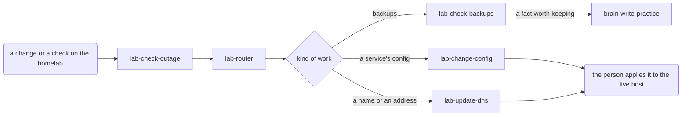

# The routing map and routers

How to draw a skill into the map, what `routing sync` makes of the drawing, and how to write a
router. `SKILL.md` step 2 says when; this file says how.

## The two map files

- `docs/ROUTING.md`: this brain's own skills. The brain owns it; the skill gate reserves it for
  `brain-write-skill`.
- `_meta/ROUTING-META.md`: the `brain-*` skills. The template owns it; never edit it in a brain.

The harness reads both as one graph. A diagram in `docs/ROUTING.md` hands on to a shipped skill by
using its id (`brain-write-practice`), without declaring it again.

## The dialect

Each diagram is a `mermaid` code fence under its own `##` section, starting `flowchart LR` (or `TD`,
`TB`, `BT`, `RL`). One statement per line:

```text
ID(label):::class       declare a node: shape and label (skills need neither), then its class
ID                      a node declared elsewhere, in any diagram of either file
A --> B                 A calls B
A -.-> B                A calls B only sometimes
A -->|when| B           the label says when
A --> B --> C           a chain is one edge per arrow
%% text                 a comment
```

- **A lowercase id is a skill, and it is the skill's exact name**: `lab-check-backups:::work`. A
  lowercase id with no such skill is BROKEN.
- **A capitalised id is anything else**: an entry trigger, a decision, a person acting, a store.
  Shapes: `(label)`, `[label]`, `{label}` for a decision, `[(label)]` for a store, also `((…))`,
  `{{…}}`, `[[…]]`. Quote a label that holds brackets, braces or parentheses: `KIND{"kind (from
  the title)"}`; a label can never hold `"`.
- **One class per node**, on any of its appearances, from the set below. No class anywhere, an
  unknown one, or two different ones: BROKEN. `routing sync` adds the `classDef` style lines; never
  write them yourself.
- **An id means the same node in every diagram of both files.** That is how one diagram continues
  another, so it must be deliberate: two diagrams that each use `KIND` for their own decision become
  one node and swap each other's hand-ons. Give capitalised ids names their diagram alone uses
  (`BACKUP_KIND`, `DNS_KIND`).
- **Edges are calls, not cross-references.** Draw an arrow only where one skill hands work to
  another. A "Does NOT …, which is X" clause is a boundary and is never drawn.
- **Outside the dialect, and BROKEN as an unsupported line**: `subgraph` and `end`, `style`,
  `class`, `click`, `linkStyle`, `direction`, other arrows (`---`, `==>`, `-- text -->`), `&`, and
  two statements on one line.

## Classes

| Class | Draw it for | Id |
| --- | --- | --- |
| `entry` | where work comes in, labelled in the words a person would say, because that label is what an agent matches a request against | capitalised |
| `gate` | a skill that checks everything on its path: it runs every time, in any order with the other gates, and its result is recorded even when it is clean | skill |
| `work` | a skill that does the work | skill |
| `optional` | a skill that runs only sometimes: offered alongside (a router's `also`), or on request | skill |
| `decision` | a branch on what kind of input this is | capitalised, `{label}` |
| `state` | a store the work reads or writes: a log, a folder, a file | capitalised, `[(label)]` |
| `human` | where a person acts: approves, applies, sends, pushes | capitalised |

A gate's class is its phase; the arrows between gates are layout, not order. A gate that was
skipped and a gate that found nothing look the same afterwards, which is why its result is written
down either way.

The map's `gate` class is not the skill gate. `:::gate` marks a checking skill that every path
through it runs; the skill gate (gates.md, next to this file) is the hook that refuses a write until
a skill has run. A skill can be either, both or neither.

## What `routing sync` makes of it: contraction

Each skill's block is computed from the graph contracted through every node that is not a skill:

- `lab-router --> KIND{…} --> three skills` gives `lab-router` three hand-ons.
- Every capitalised node is walked through, a `human` or `state` node included: in
  `lab-a --> APPROVE(the person approves):::human --> lab-b`, `lab-a` hands to `lab-b`.
- A skill never hands to itself: a loop back to the same skill through a decision
  (`lab-a --> OK{passes?}:::decision -->|no| lab-a`) is a retry and drops out. A direct edge from
  another skill back to its caller (`lab-b -->|fails| lab-a`) is a hand-on, and `lab-b`'s block will
  say "Hand to next: `lab-a`", so draw it only when `lab-b` really hands the work back.
- A skill with nothing after it reads "Hand to next: nothing — a person takes it from here."
- Every skill must be reachable from an `entry` node, or `lint` reports a GAP.

`_meta/brain routing show` prints the entry points and the isolated skills;
`_meta/brain routing show <skill>` prints what hands to it (`up`, with `(entry)` when an entry node
does) and what it hands to (`down`). Run both before placing a skill, and again after drawing it.

## A worked example: three skills behind a router

A homelab brain: one entry point, a gate every request passes, a router, three skills, a person
applying changes, and one hand-on to a shipped skill. In `docs/ROUTING.md`:

````markdown
## Homelab work


````

`brain-write-practice` takes its class from `_meta/ROUTING-META.md`. `_meta/brain routing show
lab-router` then prints:

```text
lab-router (work)
up: lab-check-outage
down: lab-change-config, lab-check-backups, lab-update-dns
```

and `routing sync` writes into `lab-check-outage`'s `SKILL.md`:

```markdown
## Where this sits

<!-- where:begin — generated by _meta/brain routing sync; do not edit -->
**Runs after:** nothing — an entry point into the tree.

**Hand to next:** `lab-router`

**A gate on its path:** it runs every time, in any order with the other gates, including when it comes back clean. Record its result either way.
<!-- where:end -->

**Call it directly when:** something on the homelab may be down before any other work starts; it needs no earlier step.
```

The block between the markers is generated: never edit it, it is rewritten on the next sync. The
call line under it is yours. A gate rule on a skill's output adds a `**Reserved output:**` line.

## Not drawn

A skill that is deliberately left out of every diagram gets a row, so "missing" always means
"nobody drew it":

```markdown
## Not drawn

| Skill | Why it is not drawn |
| --- | --- |
| `lab-explain-network` | answers questions about the network on request; no flow hands to it |
```

The skill's name goes in backticks in the first cell. A skill with a row gets no "not in the
routing map" GAP, and its block reads `**Not in the routing map:**` followed by the reason.

## Routers

A router is the skill at an entry point that fans out to three or more skills by kind of input.
With two, a decision node and two sharp descriptions are enough. A router exists because choosing by
reading sent the same input to different skills on different days; a rule does not drift.

A router:

1. **Routes only.** It never does the work it hands on, not even "just this small part".
2. **Extracts the fields by reading the input.** That is its only judgement. It writes each value
   down before routing, so a wrong route can be traced to a wrong reading or a wrong rule.
3. **Runs every gate on the path and records each result**, clean ones included, as a `Checked`
   list wherever the brain keeps its work (or in the conversation, if it keeps none). A gate on the
   path that has not run yet is run now:

   ```markdown
   Checked:
   - lab-check-outage: clean, every service answered
   ```

4. **Decides by rule.** `_meta/brain route <router> --set kind=<value> --set title=<value>` prints
   the skill to call, any to offer alongside (`also`), the rule that matched and its `why`:

   ```text
   {"skill": "lab-change-config", "rule": 4, "also": [], "why": "Config applied to a live host goes through lab-change-config's review."}
   ```

   It calls that skill. It never overrides the answer by judgement: a route that looks wrong is a
   wrong rule, fixed in `rules.json` through `brain-write-skill`, with a case that proves the fix.

Its description names every skill it routes to, in one list: "Does NOT do the work, which is
lab-check-backups, lab-change-config or lab-update-dns." Name it `<prefix>-router`.

### rules.json

In the router's own folder, `.claude/skills/<router>/rules.json`. Ordered; the first rule whose
conditions all hold wins:

```json
{
  "default": "brain-retro",
  "rules": [
    { "when": { "title~": ["restore"] }, "skill": "lab-check-backups",
      "why": "A restore starts with checking the backup it will come from, whatever kind it was filed as." },
    { "when": { "kind": ["backup"] }, "skill": "lab-check-backups",
      "why": "Backups are checked by a test restore, which lab-check-backups does safely." },
    { "when": { "kind": ["dns"] }, "skill": "lab-update-dns",
      "why": "Names and addresses change in one place, through lab-update-dns." },
    { "when": { "kind": ["config"] }, "skill": "lab-change-config",
      "why": "Config applied to a live host goes through lab-change-config's review." }
  ],
  "cases": [
    { "input": { "kind": "config", "title": "Restore the wiki from last night" }, "expect": "lab-check-backups" },
    { "input": { "kind": "backup" }, "expect": "lab-check-backups" },
    { "input": { "kind": "dns" }, "expect": "lab-update-dns" },
    { "input": { "kind": "config", "title": "Move the wiki to the new host" }, "expect": "lab-change-config" },
    { "input": { "kind": "printer" }, "expect": "brain-retro" }
  ]
}
```

- `when` maps a field to a list of values; the condition holds when the input's value is any of
  them, ignoring case. `field~` holds when the value contains one of them, ignoring case. A rule
  matches when every condition holds; a field the input lacks fails its condition.
- `skill` and `why` are required on every rule; `also` is an optional list of skills to offer
  alongside (draw them as `optional`).
- `default` applies when no rule matches. Leave it `brain-retro` unless the brain has a reason: then
  unrouted work becomes an `UNCLASSIFIED-LOG.md` row, the queue new skills come from.
- `cases` hold an `input` (each field a value or a list) and the skill it must `expect`. Give every
  rule at least one case, and the default one.
- A specific rule goes before a broad one that would catch the same input (`title~` above, before
  `kind`). `--set` takes plain field names; `~` belongs in rules only. Repeat `--set kind=…` to give
  a field several values.

`_meta/brain route <router> --check` validates the file, checks every named skill exists and runs
every case: `ok     lab-router: 4 rules, 5 cases`, or one BROKEN line per problem.

### Extending a router for a new skill

1. Draw the edge from the router's decision node to the new skill, labelled with the kind.
2. Add its rule, above any broader rule that would catch the same input.
3. Add a case for it; keep every old case passing.
4. Add it to the router's description list.
5. Run `_meta/brain route <router> --check`, then `routing sync` and `lint`.

### Turning an entry point into a router

When a third skill joins an entry point that already hands to two, write the router through this
same skill: the router becomes the entry's only hand-on, the old edges move behind its decision
node, and each existing skill gets its rule and case before the new one does.
