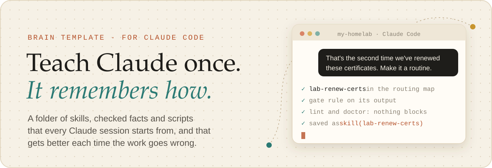
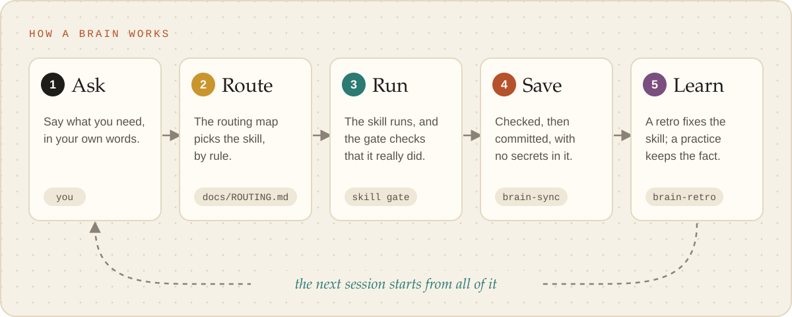
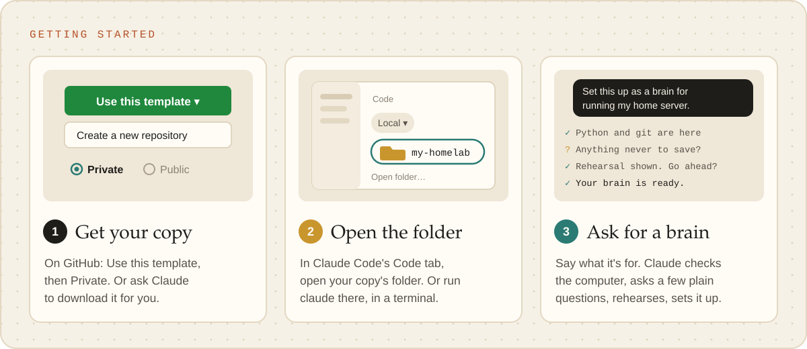
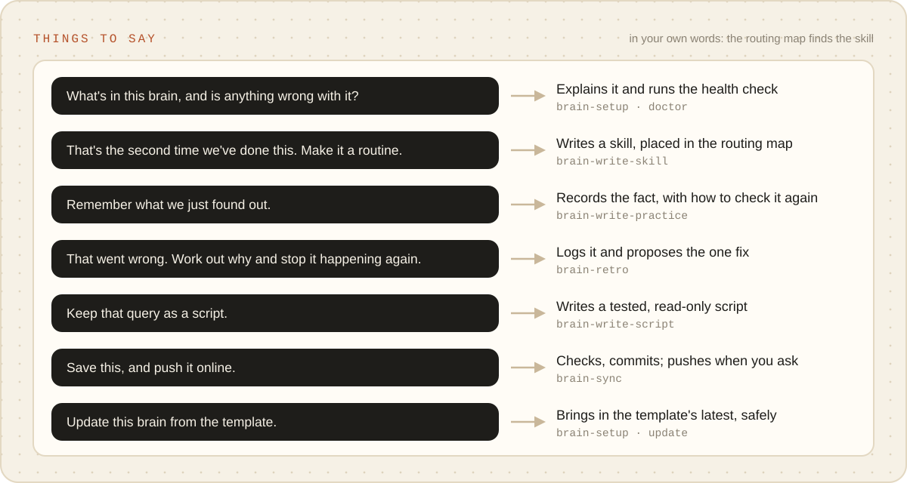
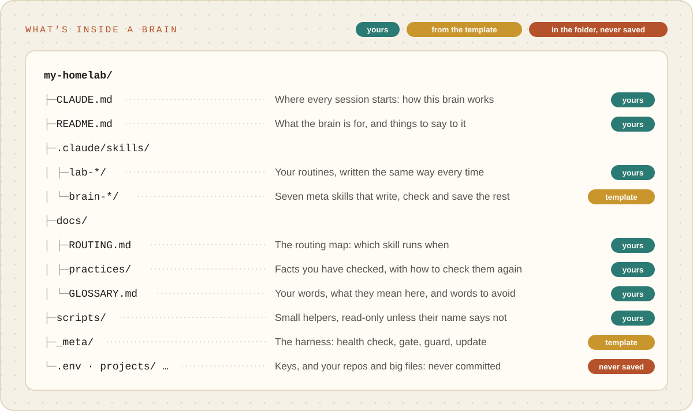
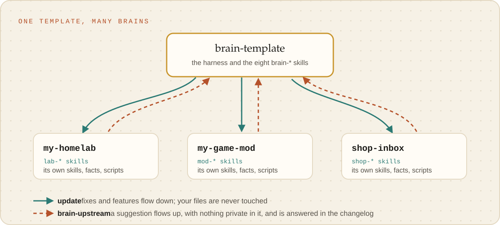
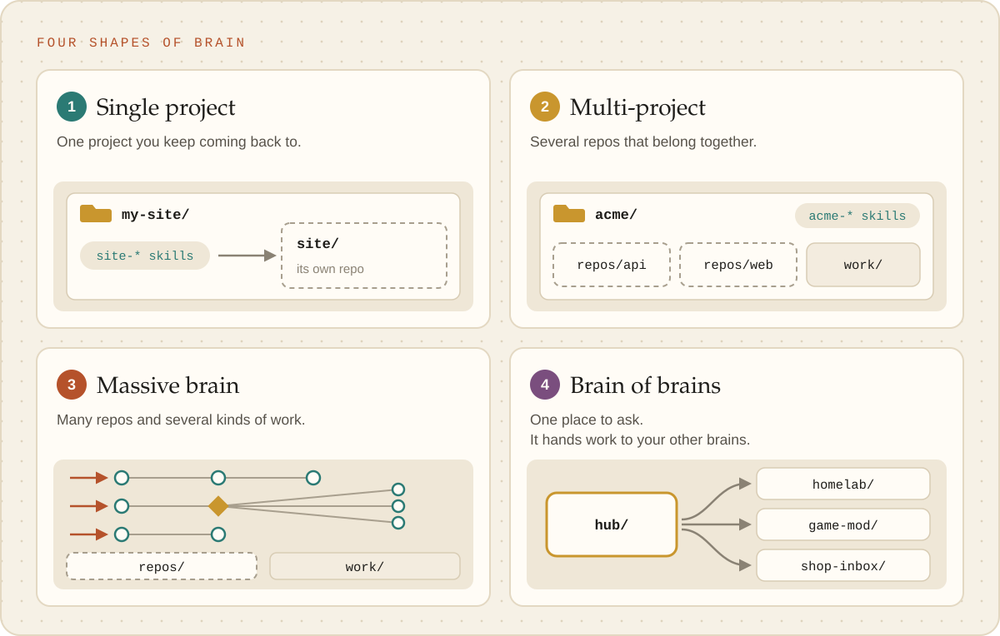

  <picture><source media="(prefers-color-scheme: dark)" srcset="docs/images/banner-dark.svg"></picture>

  
  
  
  

  <a href="https://github.com/derrickmehaffy/brain-template/generate"><b>Use this template</b></a> ·
  <a href="docs/guides/start-here.md"><b>Start here</b> (no git needed)</a> ·
  <a href="docs/guides/prompts.md">Things to say</a> ·
  <a href="docs/README.md">Docs</a>

Claude Code is sharp within a session and starts from zero in the next one. A **brain** fixes that.
It is a folder you open Claude in, holding what Claude needs to do one kind of work well: the
routines it follows, the facts it has checked, the words you use and the small scripts it runs.
Every session starts from all of it, and every change is saved in git, so nothing learned is lost
and anything can be undone.

Make one for a home server, a game mod, a customer inbox, a research project: anything you do with
Claude again and again. A new brain starts with no routines of its own, just eight meta skills
that write the rest the same way every time.

## Why a brain

- 🧠 **It remembers.** Routines become skills, checked facts become practices, and your words go
  in a glossary. Every session starts from all of it.
- 🧭 **It picks the right routine.** One routing map says which skill handles what, so the work
  is never improvised from memory.
- 🚦 **It checks itself.** The skill gate refuses a skill's output until that skill really ran,
  and every chat opens with a health check that names anything needing attention.
- 🔒 **It keeps secrets out.** A pre-commit guard blocks `.env` files, credentials and the names
  you mark private. Keys stay in `.env` (or 1Password) and are never printed.
- 🔁 **It gets better.** When something goes wrong, a retro proposes the one change that fixes
  it, and `update` brings in the template's improvements without merge conflicts.
- 📦 **Nothing to install.** Python 3.9+ and git. No packages, no server, no extra account.

## How it works

<picture><source media="(prefers-color-scheme: dark)" srcset="docs/images/how-it-works-dark.svg"></picture>

You talk to Claude the way you normally would. The brain's `CLAUDE.md` and routing map steer each
request to the skill written for it, the skill gate makes sure that skill actually runs, and
`brain-sync` saves the result through the privacy guard. When something goes wrong, `brain-retro`
turns it into a fix, so the same mistake does not happen twice.

## Get started

<picture><source media="(prefers-color-scheme: dark)" srcset="docs/images/getting-started-dark.svg"></picture>

1. **Get your copy.** Click **[Use this template](https://github.com/derrickmehaffy/brain-template/generate)**, then **Create a new
   repository**, and choose **Private**. Or ask Claude to download the template for you.
2. **Open it in Claude Code.** In the desktop app's Code tab, open the folder. In a terminal, run
   `claude` there.
3. **Say "Set this up as a brain for &lt;what you do&gt;."** Claude checks the computer, asks a few
   plain questions, shows a rehearsal of what it will do, and sets the brain up when you say yes.
   Add **"grill me"** and it interviews you first, so the brain starts out knowing your goals, your
   systems and how you work.

> [!NOTE]
> **Your copy becomes yours.** Setup removes everything that is only there for developing the
> template: this README, the tests and the GitHub files (licence, issue forms, CI), and the docs too,
> unless you ask to keep the guides for a while. What is left is a clean brain with a README of its
> own. The licence for the harness and the `brain-*` skills travels in `_meta/LICENSE`.

**Never used git or a terminal?** [Start here](docs/guides/start-here.md) walks through every click,
and Claude does the technical parts. You need macOS or Linux (on Windows, inside WSL), Claude Code,
Python 3.9+ and git; Claude checks for the last two and helps install them.

## Things to say

<picture><source media="(prefers-color-scheme: dark)" srcset="docs/images/things-to-say-dark.svg"></picture>

Say it in your own words: the skill descriptions and the routing map find the right skill. More, by
step and by kind of work, in [docs/guides/prompts.md](docs/guides/prompts.md).

## What's inside a brain

<picture><source media="(prefers-color-scheme: dark)" srcset="docs/images/whats-inside-dark.svg"></picture>

The projects, big files and keys the work produces live in the same folder but are never part of the
brain. Its `.gitignore` is an allowlist, so a nested repo, a generated asset or a `.env` is never
staged by accident.

## One template, many brains

<picture><source media="(prefers-color-scheme: dark)" srcset="docs/images/template-and-brains-dark.svg"></picture>

Make one brain per kind of work. Every brain pulls the template's fixes with `update`, and sends
ideas back with `brain-upstream`; the template and a brain never write into each other.

## Four shapes of brain

<picture><source media="(prefers-color-scheme: dark)" srcset="docs/images/shapes-dark.svg"></picture>

The same brain, fitted to how your work is laid out. Setup picks one with you, and it can change
later.

| Shape | For | Guide |
| --- | --- | --- |
| **Single project** | one project you keep coming back to: a site, an app, a home server | [single-project.md](docs/guides/single-project.md) |
| **Multi-project** | several repos that belong together, sharing people and systems | [multi-project.md](docs/guides/multi-project.md) |
| **Massive brain** | many repos and several kinds of work, each with its own chain of routines | [massive-brain.md](docs/guides/massive-brain.md) |
| **Brain of brains** | one place to ask; it hands work to your other brains, or tells you where to go | [brain-of-brains.md](docs/guides/brain-of-brains.md) |

## Go deeper

| I want to… | Read |
| --- | --- |
| Set up my first brain without touching a terminal | [Start here](docs/guides/start-here.md) |
| Pick the right shape for my work | [Choosing a shape](docs/guides/choosing-a-shape.md) |
| Know what to say to Claude at each step | [Prompts](docs/guides/prompts.md) |
| Grow a brain from real work | [Making a brain, and letting it grow](docs/guides/making-a-brain.md) |
| Build a mod: a pane, a status band, a hook | [Building mods](docs/guides/building-mods.md) |
| See every command | [Commands](docs/reference/commands.md) |
| Know which settings and skills load where | [What loads where](docs/reference/what-loads-where.md) |
| Understand routing and the skill gate | [Routing and the gate](docs/reference/routing-and-the-gate.md) |
| Know what the privacy guard blocks | [The privacy guard](docs/reference/privacy-guard.md) |
| Keep a brain current, or suggest a change | [Updates and upstream](docs/reference/updates-and-upstream.md) |

Everything else is indexed in [docs/](docs/README.md).

## Contributing

[CONTRIBUTING.md](CONTRIBUTING.md) covers setting up a checkout, the checks and how changes are
proposed; [CLAUDE.md](CLAUDE.md) is the working agreement for Claude sessions on the template, and the
original design is in `docs/superpowers/specs/`. Report vulnerabilities as [SECURITY.md](SECURITY.md)
says, and see the [code of conduct](CODE_OF_CONDUCT.md).

## License

[MIT](LICENSE). A brain made from the template carries the licence for the harness and the
`brain-*` skills in `_meta/LICENSE`; everything else in a brain is its owner's own.
