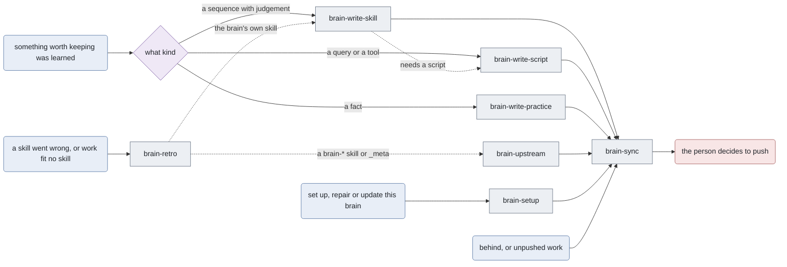

# Routing map of the meta skills

Which of the `brain-*` skills hands on to which. Every brain ships with these skills and this file;
the template owns it and `_meta/brain update` replaces it, so a brain never edits it. The harness
reads it together with the brain's own `docs/ROUTING.md` as one graph: a diagram there hands on to a
skill drawn here by using its id (`brain-write-practice`, `brain-retro`), without declaring it again.
The brain's `docs/ROUTING.md` describes the dialect, which `_meta/brain lint` enforces.

## The meta skills

## Not drawn

A meta skill that is deliberately not drawn goes here with the reason, so "missing" always means
"nobody drew it".

| Skill | Why it is not drawn |
| --- | --- |
