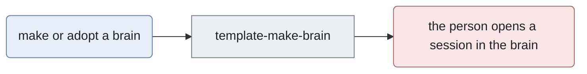
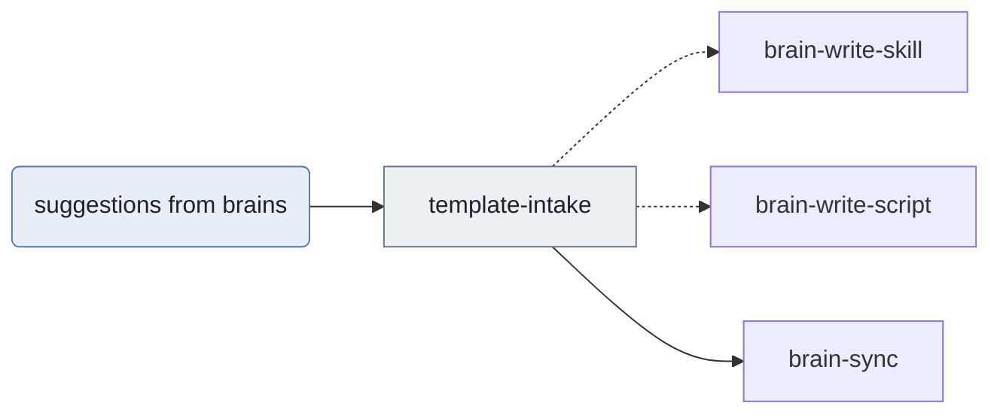

# Routing map of the template

Which of the template's own skills (`template-*`) hands on to which. They never ship: a brain gets
the skeleton's `docs/ROUTING.md`, never this file. Sessions here also use the shipped `brain-*`
skills on the template itself; those are drawn in `_meta/ROUTING-META.md`, which the harness reads
with this file as one graph, so the diagrams below hand on to them by id.

The dialect is the one every brain uses, enforced by `_meta/brain lint`: one `flowchart` per section;
a lowercase id is a skill and is its exact name, a capitalised id is anything else; each node gets
one class (`entry`, `gate`, `work`, `optional`, `decision`, `state`, `human`); `-->` is a call and
`-.->` a call that happens only sometimes. `brain-write-skill` places a skill here and
`_meta/brain routing sync` writes the `## Where this sits` block of every skill from both maps.

## Making brains

## Taking in suggestions

## Not drawn

A skill that is deliberately not drawn goes here with the reason, so "missing" always means "nobody
drew it".

| Skill | Why it is not drawn |
| --- | --- |
