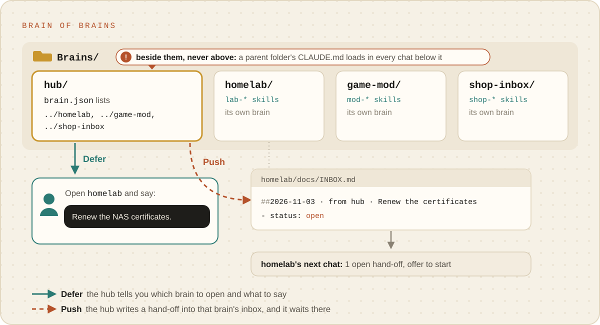

# Brain of brains

**One place to ask, when you have several brains.** A hub knows what each of your brains is for.
Ask it anything; it works out which brain the request belongs to, then either tells you where to go
and what to say, or leaves the work in that brain's inbox for its next chat. It never does another
brain's work itself.

<p align="center"><picture><source media="(prefers-color-scheme: dark)" srcset="../images/brain-of-brains-dark.svg"></picture></p>

## Is this you?

- You have two or more brains (a home server, a game mod, a side business) and sometimes forget
  which one a job belongs to.
- You want to drop a request somewhere and have it waiting in the right brain later.
- Work turns up that fits none of your brains, and you want to notice when it is time for a new one.

## What it looks like

```
Brains/
├─ hub/          ← the hub: start "where does this go?" chats here
├─ homelab/      ← brains it knows, listed in hub/brain.json
├─ game-mod/
└─ shop-inbox/
```

**Beside them, never above them.** Claude Code loads the instructions of every folder *above* the one
a chat starts in. A hub that held your brains would pour its own instructions into every chat in
them. Siblings stay independent.

## Set it up

**Say:** "Set this up as a hub for my other brains. They're next to this folder." Setup checks each
folder really is a brain, lists them, and writes the hub's one routine: picking the right brain.

**Under the hood:** `init --name "Hub" --prefix hub`, then `_meta/brain brains add ../homelab` for
each brain (it refuses a folder that is not one), then `brain-write-skill` writes `hub-route-work`.
The commands and the inbox format are in [Several brains](../reference/several-brains.md).

## How work moves

1. **You ask the hub.** "The NAS certificates expire on Friday."
2. **It picks the brain.** It reads each brain's description, its things-to-say list and the entry
   points of its routing map, and says which brain and why.
3. **It defers, by default:** "Open homelab and say: *Renew the NAS certificates; they expire
   Friday.*" You stay in charge of when the work happens.
4. **Or it pushes, if you ask:** "Queue it there." The hub leaves an open entry in
   `homelab/docs/INBOX.md` with everything it already knows. It writes nothing else in that brain
   and saves nothing there.
5. **The other brain picks it up.** Homelab's next chat opens with "1 open hand-off: Renew the NAS
   certificates", offers to start, works it through its own routines and safety rails, then marks
   it done.

## A week with it

- "Which brain handles invoices?"
- "Queue a note in game-mod: the new release breaks the save format."
- "What's waiting in my brains?" The hub lists each brain's open hand-offs.
- "That's the third request this month that fits none of my brains." Perhaps it is time for a new
  one.

## Watch out for

- **The hub's own rules apply only in the hub.** Each brain keeps its own gate and settings, which
  is exactly why the hub hands work over instead of doing it.
- **Moving a brain breaks its line in the list.** The health check names a listed brain that is no
  longer where the hub expects it.
