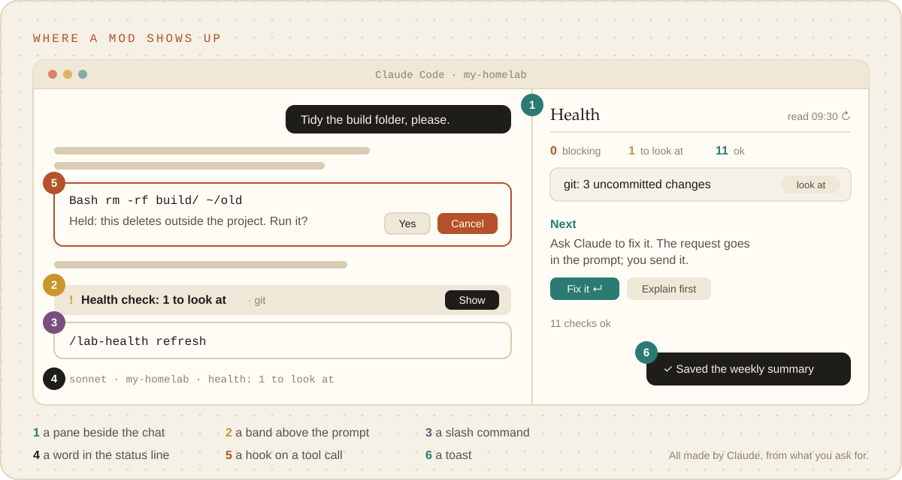
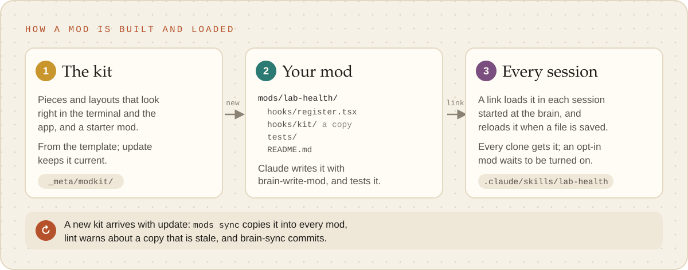

# Building mods

A **mod** changes Claude Code itself, not just what Claude knows. It can keep a list beside the
chat, put a one-line warning above the prompt, add a command that answers at once, or stop a risky
command before it runs. You describe what you want in plain words; Claude builds it from the
brain's mod kit, tests it, and the brain keeps it, so every session (and every copy of the brain)
has it.

## Is this for you?

A mod is the right thing when you want Claude Code to **show** you something while you work, or to
**react** by itself when something happens:

- a pane that lists what is open, what failed, or what is due;
- a band above the prompt that only appears when something needs you;
- a word in the status line (the branch, a count, a health check);
- a slash command that answers instantly, without a Claude turn;
- a guard that holds a risky command and says why.

It is the wrong thing when you want Claude to follow steps (that is a skill), remember a fact (a
practice) or reach a system (a script or an MCP server). Ask for those instead.

You need Claude Code 2.1.287 or newer in a terminal, or the Code tab of the desktop app. The
desktop app runs no plugins in a WSL session, so on Windows use `claude` in the WSL terminal. The
VS Code extension draws panes from version 2.1.299, and `claude -p` runs a mod's hooks but draws
nothing. Not sure? Ask "Can this computer run mods?"

<p align="center"><picture><source media="(prefers-color-scheme: dark)" srcset="../images/mods-where-dark.svg"></picture></p>

## Ask for it

Say it in your own words. Some starting points:

| Say | You get |
| --- | --- |
| "Show me above the prompt when the health check finds something." | the starter mod: a band, a pane and a command |
| "Make a pane listing the practices that are due for a recheck." | a pane that reads the brain's own files |
| "Add a command `/lab-retro` that puts a retro request in the prompt." | a command that routes to a skill, for you to send |
| "Hold any `rm -rf` or force push and tell me why." | a guard on Claude's shell commands |
| "Put the branch and unpushed commits in the status line." | a status line entry |
| "Make that mod opt-in." / "Turn the health mod off for me." | the same mod, on only for whoever turns it on |
| "The pane is empty." / "The band disappeared." | Claude reads why the mod failed and fixes it |

Claude uses `brain-write-mod`: it asks what the mod shows, reads and changes, starts from the kit,
writes tests, and asks you to look at it in the app you use. When you are happy, `brain-sync` saves
it, and the next session (anyone's, in any copy of the brain) loads it.

Watch out for:

- **A mod runs as you.** It can read and write your files, run programs and use the network. The
  brain's mods write nothing unless you asked, and their buttons put a request in the prompt for
  you to send. Only add a mod from someone else after reading what it does.
- **Everyone with the brain gets it.** A mod only you want is made opt-in.
- **If something goes wrong,** say "turn that mod off". Starting Claude with `--safe-mode` runs
  without any mod for one session.

## Under the hood

The rest is for whoever builds or reviews a mod. The authority is the API declaration Claude Code
writes beside a loaded mod (`.claude-plugin/types/claude-code/index.d.ts`, with every event, method
and element of the build you run) and the [mods documentation](https://code.claude.com/docs/en/plugins/mods/overview).

<p align="center"><picture><source media="(prefers-color-scheme: dark)" srcset="../images/mods-how-dark.svg"></picture></p>

### Where a mod lives and how it loads

A mod is a [plugin](https://code.claude.com/docs/en/plugins/overview) whose `hooks/hooks.json`
names a hooks module. A brain keeps each one in `.claude/mods/<prefix>-<name>/` and commits a relative
link, `.claude/skills/<prefix>-<name>`, to it. Mods live under `.claude/` because it is Claude's own
space: a `mods/` folder you already have, whatever it holds, is never mistaken for one. Claude Code loads a plugin folder it finds in the
project's `.claude/skills/` (it shows as `<name>@skills-dir`), only in sessions started at the
brain's root and only once that folder is trusted, and
[watches it](https://code.claude.com/docs/en/plugins/loading), so a saved change reloads the mod.
No install step, nothing in the person's user settings, and nothing loads in other folders.
A mod whose `plugin.json` says `"defaultEnabled": false` is opt-in: someone turns it on with
`"<name>@skills-dir": true` under `enabledPlugins` in their `.claude/settings.local.json`.

A mod may import only files inside its own folder, so each carries a copy of the kit in
`hooks/kit/`. `_meta/brain mods new <name>` starts one from the starter with the kit and the link;
`mods sync` refreshes every copy after `update` brings a new kit; `mods check` runs Claude Code's
own validation and tests; `lint` (and so `doctor`) reports a missing link, a stale copy, a mod with
no tests or no README. `_meta/modkit/README.md` lists every command, piece and rule.

### The kit

`makeKit(env)` binds the kit to one drawing, and every piece is a function of plain data:
`k.Card(...)`, `k.Row(...)`, `k.Overview(...)`. The pieces keep the rules that make a mod feel
native: one primary button per view, colour never alone (a glyph or a word with every tone), theme
colour names so light and dark follow the app, lists whose times and actions line up, a band of
one row, and no heading over an empty zone. Every piece draws on every surface: where an element
is missing (no Svg in the terminal, no Client in VS Code, no Input on a phone) it falls back to
text. See all of it with `claude --plugin-dir _meta/modkit/gallery` and `/modkit`.

### The hooks a brain mod uses most

| To | Hook or call |
| --- | --- |
| add a command | `$.command.register` in `session.start`, answered by `command.run` returning `{ text }` |
| open and draw a pane | `$.ui.open({ id, title })`, drawn by `ui.render` on `{ component: 'Pane', requestId: id }` |
| draw the band above the prompt | `ui.render` on `{ component: 'AbovePrompt' }`; `return next(e)` when there is nothing to say |
| a status line word, a toast | `$.ui.status(text)` (`undefined` clears it), `$.ui.toast(text)` |
| put a request in the prompt | `$.prompt.fill({ text, mode: 'replace' })`, never `$.prompt.submit` from a button |
| react to or guard a tool call | `tool.call` with a matcher such as `{ tool: 'Bash' }`; `{ deny }` refuses it |
| keep values a drawing reads | `atom`, `read`, `update` from `'claude-code'`, declared in `types/index.d.ts` |
| run a script, read a file | `$.process.run(argv, { timeoutMs })`, `$.fs.read(path)` |

Four recipes, beside the starter (which is the band-from-the-health-check one):

```tsx
// A command that routes to a skill: it fills the prompt, the person sends it.
on('session.start', async ($, e, next) => {
  await $.command.register({ name: 'lab-retro', description: 'Put a retro request in the prompt' })
  return next(e)
})
on('command.run', { command: 'lab-retro' }, async ($, e) => {
  await $.prompt.fill({ text: `Run brain-retro on ${e.args.trim() || 'what just went wrong'}`, mode: 'replace' })
  return { text: 'A retro request is in the prompt: edit it, then send it.' }
})

// A guard that fails closed: if the check itself breaks, the command does not run.
const RISKY = /\brm\s+-[a-z]*(rf|fr)\b|\bgit\s+push\b.*--force\b/
on('tool.call', { tool: 'Bash' }, ($, e, next) =>
  RISKY.test(e.command) ? { deny: `${$.plugin.name}: held; ask the person before running this` } : next(e),
).catch(($, e, next) => (next.called ? next(e) : { deny: `${$.plugin.name}: its check failed, so this did not run` }))

// A status line word, read after a turn, never while drawing.
on('turn.complete', async ($, e, next) => {
  try {
    const ran = await $.process.run(['git', 'status', '--porcelain', '--branch'], { timeoutMs: 5000 })
    const ahead = ran.stdout.match(/ahead (\d+)/)?.[1]
    $.ui.status(ahead ? `${ahead} unpushed` : undefined)
  } catch { /* the status line stays as it was */ }
  return next(e)
})

// A pane of the brain's own data: a script prints JSON, the mod reads it in the background.
const items = atom({ plugin: 'lab-due', key: 'items' } as const, [], { shape: 'items-1' })
async function reload($: EngineInterface) {
  const ran = await $.process.run(['python3', 'scripts/practices/list_due.py', '--json'], { timeoutMs: 30_000 })
  await update($, items, () => JSON.parse(ran.stdout))
}
```

### Testing

`claude plugin test <mod folder>` runs every `*.test.ts` in the mod with no session, sign-in or
network, and `_meta/brain mods check` runs it with `claude plugin validate` for each mod. A test
mounts the pane or band on a surface it names and presses, types and finds by key; write the body
once and loop it over `terminal` and `desktop`. Nothing runs beneath the mod in a test, so stub
what Claude Code would answer, before the test's first call on `$`: `process.run` answers
`{ value: { exitCode, stdout, ... } }` (or `{ deny }` to make it fail), `prompt.fill` answers
`{ isFilled: true }`, and a hook that returns `next(e)` needs a `ui.render` stub to draw the
engine's part. `session.start` does not run by itself: fire it. Test the states people hit (empty,
reading, failed, nothing to show), a forged button post, a value an older version stored, and that
a read-only mod wrote nothing. The [testing guide](https://code.claude.com/docs/en/plugins/mods/test)
has the rest.

The template's CI runs Python only, so the kit's TypeScript tests run where `claude` is installed:
`tests/test_modkit.py` runs them when it finds `claude` on PATH and skips them otherwise.

### Performance

- A `ui.render` hook only reads state and builds a tree. Run processes, reads and network calls
  from a command, a button, `session.start` or a throttled `turn.complete`, in the background,
  with a time limit, and write the result to state: the write redraws exactly the readers.
- Share a read in progress rather than starting a second one, and throttle work that follows
  events (the starter reads again after a turn at most every five minutes).
- Limits that bite: 10 seconds of a hook's own time per event (1 second for a `.catch`), 30 seconds
  by default for `$.process.run`, 100,000 characters of text per tree, and redraws throttled to 10
  a second (30 in the terminal). Draw the part in view, not the whole list.
- Hooks on `tool.call` and `prompt.submit` sit in the way of every call and prompt: observe and
  pass on, and keep anything slow out of them.

### When it goes wrong

| What you see | Why, and the fix |
| --- | --- |
| A dim line `<mod>: <event> hook skipped: …` | the hook threw, timed out or returned the wrong shape; a `ui.render` tree with a prop an element does not take counts. Read the reason; `claude --debug` has every occurrence |
| The pane or band is empty | its tree was refused (the engine draws its own), or the hook returned `next(e)`; check the skipped line |
| The mod does not load at all | the session started somewhere other than the brain's root, the folder is not trusted yet, the link is missing (`_meta/brain mods list`), or an organisation's managed settings block `.claude/skills/` plugins (load it with `claude --plugin-dir mods/<name>` instead) |
| Values reset after an edit | a reload runs `register` again: module variables start over. Keep what a drawing needs in `$.state`, and change an atom's `shape` tag when its fields change |
| A desktop button needs two clicks | the kit draws desktop buttons as a Client for exactly this; build buttons through the kit |
| Nothing draws in `claude -p` or on a phone | those surfaces draw nothing or little: make the command's text reply carry the answer |

A mod should fail quiet and visible: no hook throws, a failed read keeps the last good one and says
so in the pane with a Try again button, and a guard gets a `.catch` that refuses, so a broken guard
fails closed instead of waving everything through.

### Security

- **It runs as you, unsandboxed.** Anything a mod starts runs outside Claude's sandbox. Keep mods
  read-only unless the person asked for a write, and make any outward act ask first.
- **Never a secret.** A mod never reads `.env`, never keeps a key in state, a toast, a log or a
  drawing, and never sends one anywhere. A system that needs a key is reached through a script
  that loads it, or `_meta/brain secret run`.
- **Validate every press.** A button carries a small act that one function checks before anything
  runs: never free text, a path, a URL or a command, and the prompt text it fills comes from a
  fixed list in the mod.
- **Do not widen permissions.** A mod can approve a tool call that would otherwise ask; a brain's
  mods never do. They add a view; the skill gate and the settings decide.
- **Read before you trust.** `claude plugin validate <folder>` lists every event a mod hooks and
  every call it makes (files, processes, network) without running it.

### Sharing a mod beyond the brain

A brain's mods travel with the brain. To give one to people without the brain, copy its folder
into a repository of its own with a `.claude-plugin/marketplace.json`, after checking it holds no
key, internal address or private name; they install it with `/plugin install <mod>@<marketplace>`.
The [publishing guide](https://code.claude.com/docs/en/plugins/publish) covers the rest.

### Further reading

[Create a mod](https://code.claude.com/docs/en/plugins/mods/create) ·
[Draw in the interface](https://code.claude.com/docs/en/plugins/mods/interface) ·
[React to events](https://code.claude.com/docs/en/plugins/mods/events) ·
[The mods API](https://code.claude.com/docs/en/plugins/mods/api) ·
[Troubleshoot a mod](https://code.claude.com/docs/en/plugins/mods/troubleshoot) ·
[Mods for an organisation](https://code.claude.com/docs/en/plugins/mods/admin) ·
[Reference](https://code.claude.com/docs/en/plugins/mods/reference)
