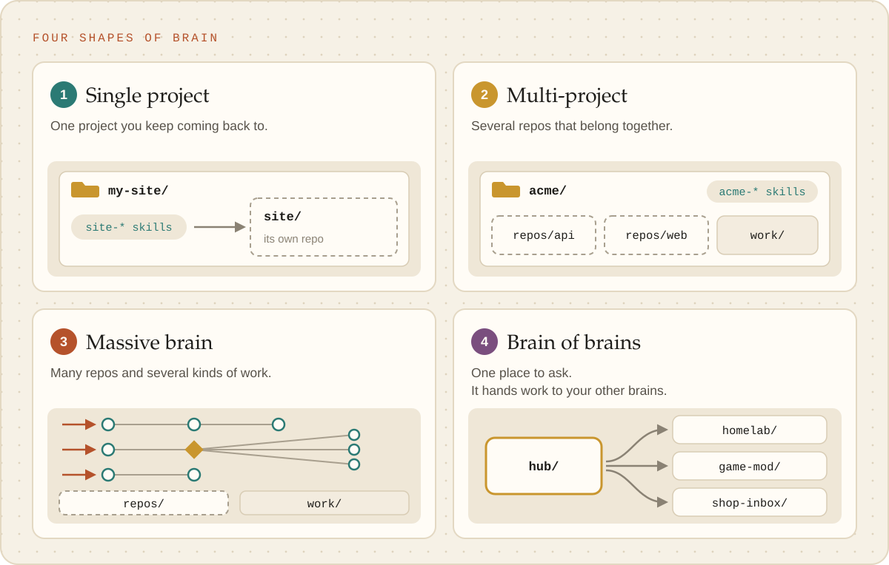

# Choosing a shape

Every brain is the same machine underneath. What differs is its **shape**: where the work it looks
after lives, and how its skills reach that work. Setup picks one with you, and you can change it
later. Nothing about the shape is permanent.

<picture><source media="(prefers-color-scheme: dark)" srcset="../images/shapes-dark.svg"></picture>

## Which one is you?

| If you… | Your shape | Read |
| --- | --- | --- |
| look after **one thing** again and again: a website, an app, a book, a home server | **Single project** | [single-project.md](single-project.md) |
| look after **several repos that belong together**: a company's services, a family of libraries, a client's sites | **Multi-project** | [multi-project.md](multi-project.md) |
| run **several kinds of work** across many repos and systems: releases, incidents, customer questions, reporting | **Massive brain** | [massive-brain.md](massive-brain.md) |
| already have **several brains** and want one place to ask "where does this go?" | **Brain of brains** | [brain-of-brains.md](brain-of-brains.md) |

Not sure? Start with a single project. A brain grows into the next shape when the work asks for it,
and the guides say when that is.

## What every shape has in common

- **Start every chat in the brain's folder.** It is the only place where the brain's safety rails
  (the skill gate, the `.env` protection, its connected apps) load. The technical detail is in
  [What loads where](../reference/what-loads-where.md).
- **Projects live inside the brain's folder but are not part of the brain.** Each keeps its own
  history and its own online copy; the brain only keeps what Claude learned about working on it.
- **Skills, facts and scripts grow from real work.** No shape needs them written up front.

## Say it

> "Set this up as a brain for my marketing site."
>
> "Grill me first, then set this up. I look after our company's six repos."
>
> "I have three brains already. Make this one a hub that knows about them."

Setup turns any of these into the right layout, and shows you a rehearsal before it writes anything.
