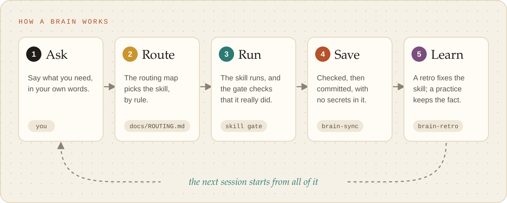
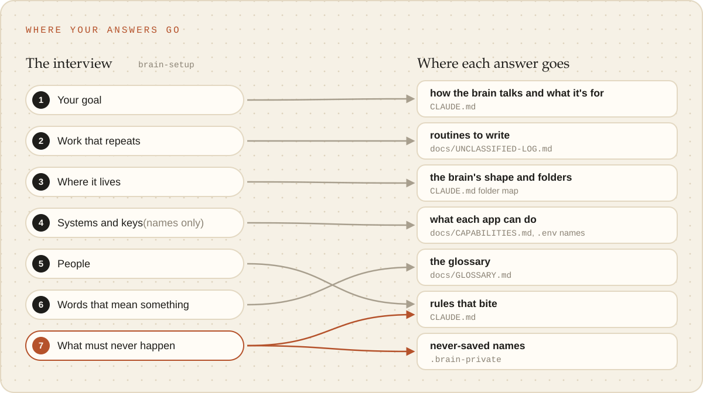
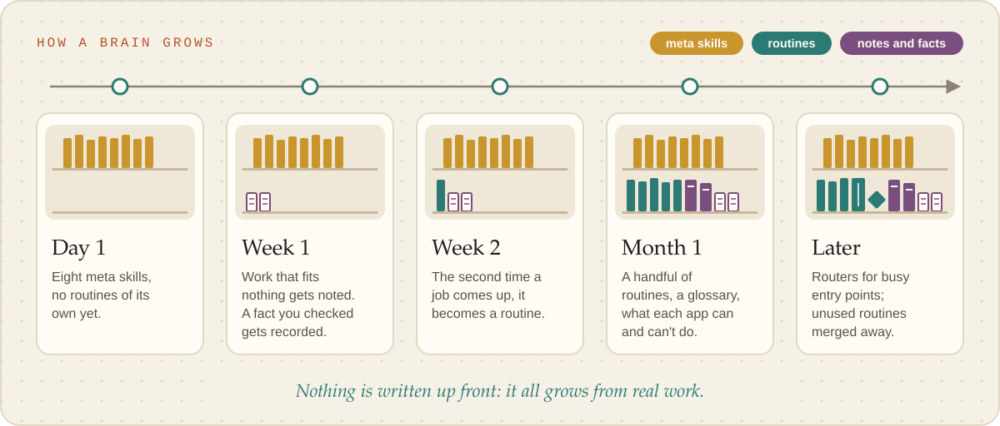
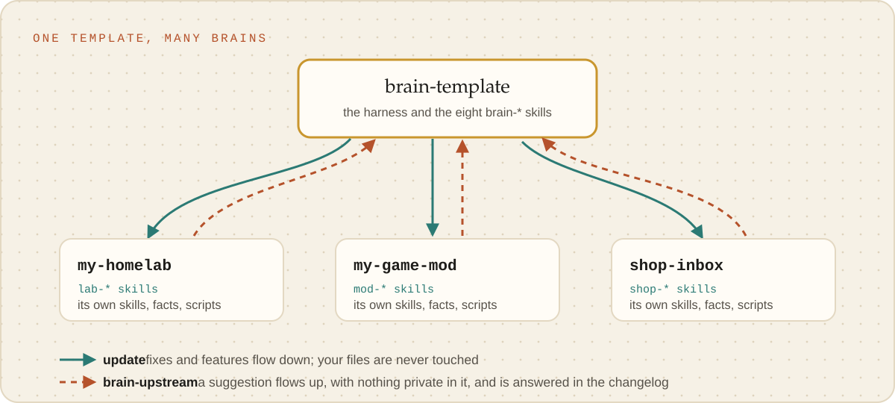

# Making a brain, and letting it grow

A brain is worth making when you keep re-explaining the same context to Claude, the same mistakes
come back, or the work keeps touching the same few systems. This guide is the judgement around
setup: when to make one, what to decide first, and how it grows from real work into something that
knows your job. For the clicks, see [Start here](start-here.md); for things to say, [Prompts](prompts.md).

<picture><source media="(prefers-color-scheme: dark)" srcset="../images/how-it-works-dark.svg"></picture>

## One brain per kind of work

A brain is for work you do again and again with Claude: a homelab, a game you mod, the open-source
projects you maintain, a team's support desk. It holds how to do that work well (skills, the facts
learned, what each system can and cannot do, small scripts), and the projects sit inside its folder
without being part of its history.

Do not make one for a single task, or for a project that is really part of work an existing brain
already covers: give that brain a skill instead. How a brain relates to its projects is its
**shape**: [one project, several, a massive brain, or a hub of brains](choosing-a-shape.md).

## Decide before setup

Setup asks about all of these, and the **interview** ("grill me") goes deeper: your goals, the work
that recurs, your systems, the people involved, the words that mean something specific to you.

- **The shape and the folder.** Where you would start chats for this work, and where its projects
  live. A copy of the template becomes the brain in place; from the template's own checkout, Claude
  can make one in a new folder, or turn a folder you already work in into one without moving or
  overwriting anything.
- **The prefix.** 2 to 16 lowercase letters or digits, starting with a letter. Every routine of the
  brain starts with it (`lab-check-backups`), so keep it short and unlike any other brain's. Claude
  picks one for you.
- **What must never be saved.** Hostnames, addresses, unreleased names, client or customer names,
  written as you would say them. They stay on your computer only, and the privacy guard refuses any
  commit that holds one ([how](../reference/privacy-guard.md)).
- **Where it is backed up.** A brain that holds infrastructure or customer detail goes to a private
  copy online, or stays on this computer. The guard is the second line of defence, not the first.
- **Whether to keep the guides.** They can stay in the brain while it is new, and go when you ask.

<picture><source media="(prefers-color-scheme: dark)" srcset="../images/interview-answers-dark.svg"></picture>

## Let it grow from real work

Do not write routines up front. One written from a guess routes badly and gets ignored; one written
from two real cases does not.

<picture><source media="(prefers-color-scheme: dark)" srcset="../images/growing-a-brain-dark.svg"></picture>

1. **Work as you normally would.** When work fits no routine, `brain-retro` notes it in the
   unclassified log. (After an interview, the work you described is already there.)
2. **The second time** the same kind of work turns up, `brain-write-skill` turns the two cases into a
   routine and places it in the routing map.
3. **The first time you use a system** (an API, a command-line tool, an MCP server),
   `brain-write-script` probes it and records what it can and cannot do. A query you would write
   twice becomes a script.
4. **A fact that took time to establish** goes to `brain-write-practice`, with how sure it is and
   the command that re-checks it.
5. **A word that misled** goes in the glossary, which every chat loads.
6. **When a routine gets something wrong**, run a retro straight away: one row, one proposed fix.

Most brains have a handful of routines after a month. A busy, varied one can pass thirty; then
routers matter, and the [massive brain](massive-brain.md) guide is for you.

## Connecting systems

- **MCP servers** a brain needs go in its own `.mcp.json`, through `brain-write-script`, not in your
  user settings: servers there load in every chat you start anywhere, and their tool lists cost
  attention in all of them.
- **Keys and passwords** live in `.env`, which is never saved and which Claude is not allowed to
  read. Claude adds the key's name and opens the file in your text editor for you to paste the value;
  never paste one into the chat. A 1Password reference (`op://vault/item/field`) works in place of
  the value. [Secrets and systems](../reference/secrets-and-systems.md) has the mechanics.
- **What each system can't do** is the most useful line in `docs/CAPABILITIES.md`. A dated "cannot"
  stops the next chat walking into the same wall.

## Keeping it healthy

- **Every chat starts with a health check** that says only what needs attention: unsaved work, a
  missing backup, hand-offs waiting from another brain, a template update.
- **Saving** goes through `brain-sync`, which checks, commits with a clear label, and pushes only
  when you ask.
- **Now and then**, ask which routines went unused. A routine that never runs costs every chat its
  description, so merge or remove it.
- **Updates** from the template arrive through `brain-setup`, and never touch your own files. A
  change every brain should have goes back as a suggestion through `brain-upstream`
  ([Updates and upstream](../reference/updates-and-upstream.md)).

## More than one brain

<picture><source media="(prefers-color-scheme: dark)" srcset="../images/template-and-brains-dark.svg"></picture>

Each brain has its own routines, connections and secrets, so start each chat in the brain the work
belongs to. Brains share only what comes from the template; a routine two brains both want is
copied, and each copy then changes on its own. When you have several, a
[brain of brains](brain-of-brains.md) gives you one place to ask, and hands work to the right one.
