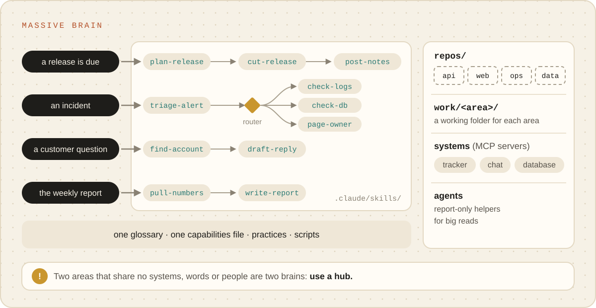

# Massive brain

**Many repos and several kinds of work**, sharing the same systems and the same vocabulary: a team
that ships releases, answers customer questions, handles incidents and writes a weekly report, all
across the same codebase and tools. It is one brain because the work shares so much; it stays usable
because each kind of work has its own entry point and its own chain of routines.

<p align="center"><picture><source media="(prefers-color-scheme: dark)" srcset="../images/massive-brain-dark.svg"></picture></p>

## Is this you?

- The brain's work no longer starts one way: a message, a date, an alert and a ticket each start a
  different kind of job.
- Several routines would each be a good first step for the same request, and Claude sometimes
  picks the wrong one.
- The same systems and words show up in every kind of work.

## What it looks like

A [multi-project](multi-project.md) layout, plus structure for each kind of work:

```
team/
├─ repos/…                     ← every repo, each its own history
├─ work/
│  ├─ releases/                ← one working folder per kind of work
│  └─ 2026-11-03-outage/       ← or per task
├─ docs/
│  ├─ ROUTING.md               ← one entry point per kind of work, routers where they fan out
│  ├─ releases/                ← what each area keeps, listed in docs/README.md
│  └─ GLOSSARY.md              ← one glossary for everything: shared words are why it is one brain
├─ .claude/skills/team-*       ← families of routines: team-triage-*, team-release-*, team-report-*
├─ .claude/agents/team-*       ← report-only helpers for big reads (a long log, a large repo)
└─ .mcp.json                   ← the systems every area uses: tracker, chat, database
```

## Set it up

**Say:** "Grill me. This brain will run our team's work across all our repos." The interview is
worth it here: the kinds of work you describe become the entry points, the systems become connections
set up one at a time, and the recurring jobs become a list of routines to write, in order.

**Under the hood:** start as multi-project. Each kind of work gets an entry node in
`docs/ROUTING.md`, written through `brain-write-skill`. When one entry point fans out to three or
more routines, `brain-write-skill` writes a **router**: a rules file that picks the routine by the
kind of input, never by guesswork, with test cases that `_meta/brain route <router> --check` runs.

## How skills attach

- **By area.** Name routines in families (`team-release-*`, `team-triage-*`), so each area's
  routines sit together and a new one has an obvious name.
- **Through routers.** A request enters at its area's entry point and the router hands it to one
  routine. When the route is wrong, fix the rule, never work around it.
- **With agents for heavy reading.** A routine that needs to read a huge log or a whole repo hands
  that to a report-only agent with its own context and a cheaper model, and gets a summary back.
- **Over shared knowledge.** One glossary, one capabilities file and one practices store serve every
  area. That is the point of keeping it one brain.

## A week with it

- "An alert fired on the API. Start an incident." enters at the incident entry point and opens
  `work/<date>-<incident>/`.
- "Draft this week's report." pulls from the tracker, the incidents folder and the release notes.
- "Which routines haven't we used in three months?" (`_meta/brain usage`): the retro merges or
  removes them, because every routine costs every chat a little attention.

## Watch out for

- **Description sprawl.** Every routine's one-line description is read in every chat. Merge
  routines that overlap; `brain-retro` proposes it.
- **One area's rules leaking into another's.** Keep area rules in the area's skills, not in
  `CLAUDE.md`, which every chat loads.

## Outgrowing it

When two areas share no systems, no words and no people, they are two brains that happen to sit in
one folder. Split them, and put a [brain of brains](brain-of-brains.md) beside them so you still have
one place to ask.
