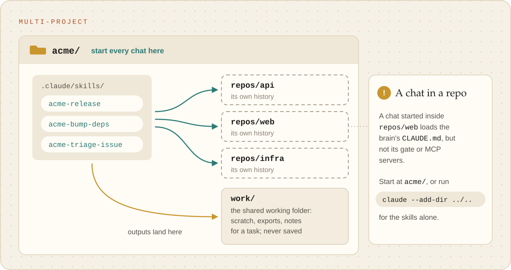

# Multi-project

**Several repos that belong together**: a company's services, a family of libraries, the sites you
build for one client. They share people, systems and vocabulary, so one brain looks after all of
them, and a routine written once works on every repo.

<p align="center"><picture><source media="(prefers-color-scheme: dark)" srcset="../images/multi-project-dark.svg"></picture></p>

## Is this you?

- You jump between repos in one day, and the same chores (releases, dependency bumps, triage) repeat
  in each.
- The repos share a tracker, a chat channel, a cloud account or a database.
- New repos appear from time to time, and you want them to inherit everything the brain knows.

## What it looks like

```
acme/                          ← the brain: start every chat here
├─ repos/
│  ├─ api/                     ← each repo cloned here, its own history
│  ├─ web/
│  └─ infra/
├─ work/                       ← the shared working folder: scratch, exports, notes for a task
├─ .claude/skills/acme-*       ← routines that take a repo name, or work across all of them
└─ CLAUDE.md                   ← one line per repo: what it is, who owns it
```

`repos/` and `work/` are never saved in the brain: its `.gitignore` is an allowlist, so they are
left out without anyone listing them.

## Set it up

**Say:** "Grill me, then set this up as a brain for our company's repos." The interview asks where
the repos are and which systems they share; setup clones each into `repos/`, makes `work/`, and
writes a folder-map line per repo.

**Under the hood:** `init --name "Acme" --prefix acme`, then one `git clone <url> repos/<name>`
per repo, on your yes. Systems the repos share (the tracker, the chat app) are connected once,
through `brain-write-script`, and recorded in `docs/CAPABILITIES.md`.

## How skills attach

To a **common working directory**, not to one repo:

- a skill takes a repo name ("release `web`") or works across all of them ("bump the logging
  library everywhere");
- it reads and changes code only in the repo it was asked about;
- what it produces (a changelog draft, an audit, a list of affected files) goes in `work/`, so no
  repo gets stray files.

**Using the skills from inside a repo.** A chat started in `repos/web/` loads the brain's
`CLAUDE.md`, but not its gate, its `.env` protection or its MCP servers. For a quick read-only
question there, `claude --add-dir ../..` brings the brain's skills along. For real work, start at
`acme/`. Do not copy the skills into your personal `~/.claude/skills`: they would run in every chat
on your computer without this brain's rules. The details: [What loads where](../reference/what-loads-where.md).

## A week with it

- "Release `api` and `web`, then post the notes in the release channel as a draft."
- "Which repos still use the old logging library? Write the list to `work/`."
- "That's the third time we triaged an issue this way. Make it a routine."

## Watch out for

- **Every repo keeps its own backup.** The health check names any repo with unpushed work: that is
  the work you would lose if this computer died.
- **One repo's rules can contradict another's.** Put the shared rules in the brain's `CLAUDE.md`
  and the repo-specific ones in each repo's own `CLAUDE.md`.

## Outgrowing it

When the brain starts doing several *kinds* of work (releases, incidents, customer questions), each
with its own chain of routines, it is becoming a [massive brain](massive-brain.md). When two groups of
repos stop sharing systems or vocabulary, they want separate brains, and perhaps a
[hub](brain-of-brains.md) over them.
