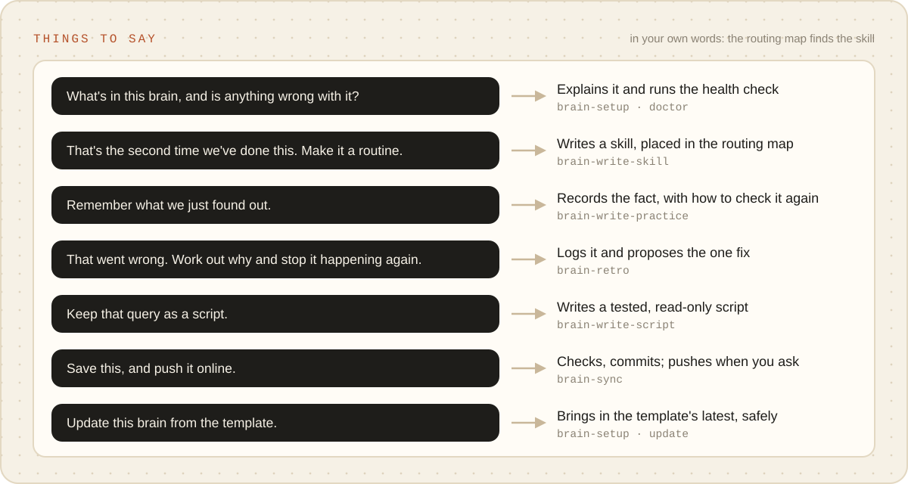

# Prompts

Things to say to Claude Code, in a session started in the right folder. Each line names the skill it
lands in, so you can word it your own way: say what you want and the descriptions and routing map pick
the skill. Naming the skill works too. Paths and names below are examples.

<picture><source media="(prefers-color-scheme: dark)" srcset="../images/things-to-say-dark.svg"></picture>

## In the template: making a brain

| Say | Lands in |
| --- | --- |
| "Make a brain for my homelab at `~/brains/homelab`, prefix `lab`. Hostnames and our address range must never be committed." | `template-make-brain` → `new` |
| "Turn `~/projects/my-mod` into a brain for modding the game, prefix `mod`. Show me what the first commit would stage." | `template-make-brain` → `adopt` |
| "Do a dry run of a brain for my open-source work at `~/brains/oss` first; don't write anything yet." | `template-make-brain` → `new --dry-run` |
| "Take in the upstream suggestions my brains have recorded." | `template-intake` |

In a copy of the template (a clone, or GitHub's "Use this template"): "Set this up as a brain for
<the work>." lands in `brain-setup`, which runs `init`.

## In a brain: every day

| Say | Lands in |
| --- | --- |
| "What's in this brain, and is anything wrong with it?" | `brain-setup` (explain, `doctor`) |
| "That's the second time we've <done X>. Make it a skill." | `brain-write-skill` |
| "Where would a skill for <X> sit in the routing map?" | `brain-write-skill` (step 2) |
| "Connect <system>'s MCP server to this brain. Read-only tools first, and record what it can and can't do." | `brain-write-script` (an MCP server) |
| "Keep that query as a script." | `brain-write-script` |
| "We'll need a token for <system>. Add the name; I'll fill in the value or an `op://` reference." | `brain-write-script` (`env-sync --add`) |
| "Make a read-only agent that <reads the big data folder> and reports back, for <skill> to use." | `brain-write-skill` (agents) |
| "Record what we just found as a practice. It's reproduced; re-check it with <command>." | `brain-write-practice` |
| "'<term>' meant two different things today. Put it in the glossary." | `brain-write-practice` (glossary) |
| "That answer was wrong. Run a retro." | `brain-retro` |
| "Which skills haven't we used in the last three months?" | `brain-retro` (`usage`) |
| "Commit this." / "Sync and push." | `brain-sync` |
| "Update this brain from the template." | `brain-setup` (`update`) |
| "Every brain should have <X>. Suggest it upstream." | `brain-upstream` |

When the gate refuses a write, the refusal names a skill. Answer "run the skill it names", never
"waive it". A waiver is for when you, the person, decide the skill does not apply this once.

## Starting points for common kinds of work

What the setup answers and the first weeks tend to look like. None of this is written up front; it is
what the brain usually grows into.

**Homelab or self-hosting** (`lab`). The folder holds compose files, an automation repo (nested, with
its own git), notes. First skills: check a service's health, add a service, recover from a failed
update. Systems: the hypervisor, home automation, DNS, backups, through MCP servers or scripts. Private
terms: hostnames, the address range, the domain. Glossary: host, node, service, stack.

**Game modding** (`mod`). The folder holds the mod's repo (nested), unpacked game data (large,
ignored) and tools. First skills: find how the game does something in its data, build and package a
release, test load order. Practices need honest evidence: "read in the game's code" is `researched`,
"tried in game" is `reproduced`. Private terms: unreleased mod names.

**Open-source maintainer** (`oss`). The folder holds the repos you maintain (nested). First skills:
triage an issue, review a pull request against the project's rules, cut a release. Systems: the forge's
API or CLI, the package registry. Gate the output that leaves the brain: release notes, public replies.

**A team's support desk or on-call rota** (`desk`). The folder holds runbooks and case notes (ignored).
First skills: a router that sends each ticket by kind, draft a reply (gated, and a person sends it),
escalate, look up an account. Systems: ticketing, chat, the status page. Private terms: customer and
internal host names. This is the kind that grows past thirty skills and needs routers.

**Writing or research** (`pen`). The folder holds drafts and sources. First skills: research a question
with sources, edit to the house style, a pre-publish check. The glossary does most of the work here.
