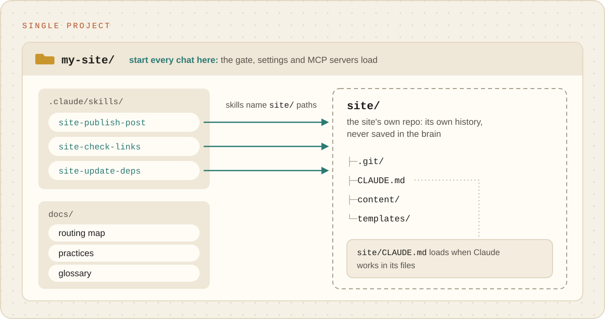

# Single project

**One project you keep coming back to**: a marketing site, an app, a book, the config of a home
server. The brain sits around the project and remembers how you work on it: how a post gets
published, which checks the site needs before a release, what broke last time and why.

<p align="center"><picture><source media="(prefers-color-scheme: dark)" srcset="../images/single-project-dark.svg"></picture></p>

## Is this you?

- You do the same kinds of jobs on one project, week after week.
- You explain the same things to Claude at the start of every chat ("we use this host", "posts need
  a hero image", "never touch the pricing page").
- The project has its own repository, or will have one.

## What it looks like

```
my-site/                       ← the brain: start every chat here
├─ site/                       ← the website's own repo (its own history, never saved in the brain)
├─ .claude/skills/site-*       ← your routines: site-publish-post, site-check-links
├─ docs/                       ← the routing map, checked facts, your words
└─ CLAUDE.md                   ← "site/ is the marketing site; deploys go through …"
```

The brain and the project are two separate histories in one folder. The brain saves what Claude
learned; the project saves the site. Backing one up never touches the other.

## Set it up

**Say:** "Set this up as a brain for our marketing site. The site's repo is at
`github.com/acme/site`." Setup clones the site into `site/`, writes the folder map and explains
it. Already have the project on this computer? Say where it is: Claude offers to move it into the
brain's folder, and moves nothing without your yes.

**Under the hood:** `init --name "Marketing site" --prefix site`, then
`git clone <url> site`. The brain's allowlist `.gitignore` leaves `site/` out automatically. A
project that must stay where it is can be reached with `permissions.additionalDirectories` in
`.claude/settings.json` instead; its own `CLAUDE.md` then loads only when Claude works in its files.

## How skills attach

Skills here name the project's paths directly (`site/content/posts/`, `site/package.json`), so every
routine knows exactly where to work. The project's own `CLAUDE.md`, if it has one, loads when Claude
works in its files, so team conventions in the repo still apply.

## A week with it

- "Publish the post in `drafts/launch.md`." The first time, Claude does it with you. The second
  time: "That's the second time. Make it a routine." Now it is `site-publish-post`.
- "Check every link before Friday's release." becomes `site-check-links`.
- "The build broke because the image was too big. Remember that." becomes a checked fact, found
  automatically next time.

## Watch out for

- **Chats started inside `site/`** load the brain's `CLAUDE.md` but none of its safety rails. Open
  the brain's folder instead.
- **The project's backup is its own.** Pushing the brain does not push the site, and the health
  check names a project with unpushed work.

## Outgrowing it

A second repo appears, or the same routines start to apply to several projects: you are becoming a
[multi-project](multi-project.md) brain. Move the project to `repos/site/`, clone the new one beside
it, and ask Claude to update the folder map and the skills' paths.
