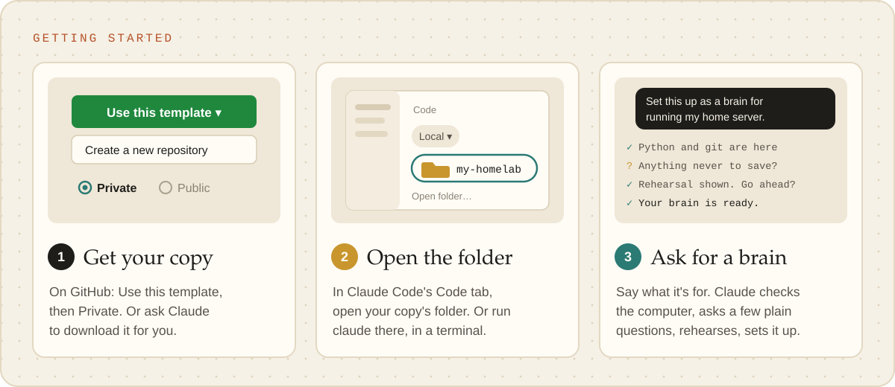
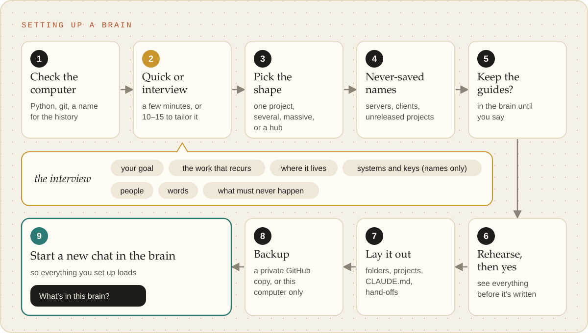
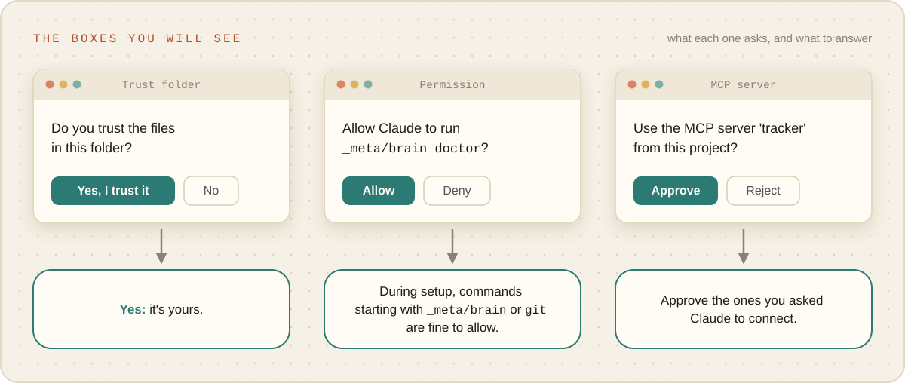
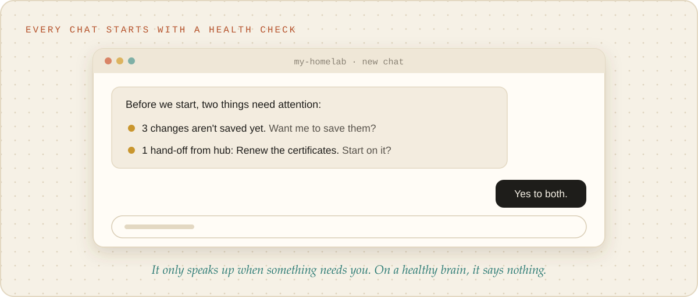
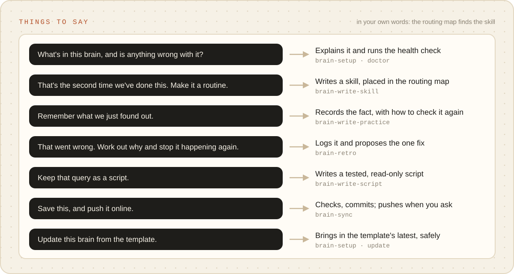
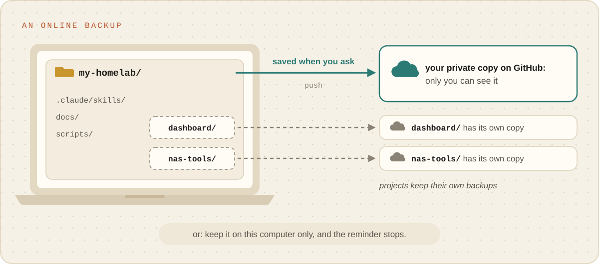
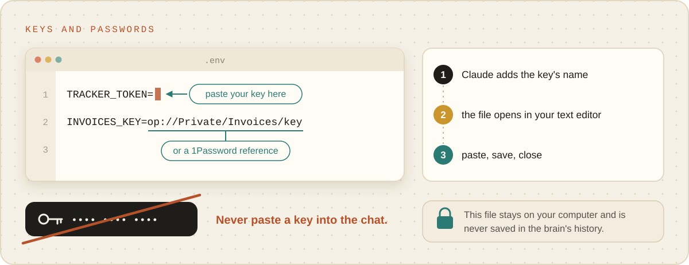

# Start here

Your own brain, from nothing, in about ten minutes, with Claude doing every technical part. You need
no experience with git, terminals or code. Claude asks plain questions, shows you what it will do
before it does it, and explains anything it needs you to click. (Comfortable with a terminal?
[Setting up](../reference/setting-up.md) has the technical version.)

<picture><source media="(prefers-color-scheme: dark)" srcset="../images/getting-started-dark.svg"></picture>

## What a brain is

A folder where Claude keeps what it learns about one kind of work you do: the routines it follows,
the facts it has checked, what your tools can and cannot do. Every time you open Claude in that
folder, it starts from all of that instead of from scratch. It also keeps a saved history of every
change, so nothing it learns is lost and any change can be undone.

## What you need

- **A Mac or a Linux computer.** On Windows, a brain works only inside WSL (Windows Subsystem for
  Linux); on Windows alone it does not work yet.
- **Claude Code**: the Code tab of the Claude desktop app (it needs a paid Claude plan), or the
  `claude` command in a terminal if you prefer one.
- **git and Python 3.9 or newer.** Claude checks for both and helps with anything missing. On a Mac,
  the first time either is needed a box may appear offering to install the "command line developer
  tools": click Install and wait for it to finish (it takes a few minutes).

## 1. Get the template

The template lives at <https://github.com/derrickmehaffy/brain-template>. Any of these works:

- **Your own copy on GitHub (best: it is backed up from the start).** With a free GitHub account,
  open the template's page, click **Use this template**, then **Create a new repository**. Name it
  after what the brain is for and choose **Private**. Then, in the Code tab with your Documents
  folder open (as in step 2), say: "Download my repository <its address> into a folder called
  `Brains/<its name>`." Claude walks you through signing in to GitHub if it needs to.
- **Let Claude download the template.** In the Code tab, open your Documents folder (as in step 2),
  and say: "Download the brain template from https://github.com/derrickmehaffy/brain-template into a
  new folder called `Brains/<a name for it>`."
- **Download it yourself.** On the template's page, click Code, then Download ZIP. Unzip it and move
  the folder somewhere you will find it again, such as Documents, and rename it to what the brain is
  for.

## 2. Open the folder in Claude

In the desktop app's Code tab: click the environment selector, choose Local, then click the folder
control beside it, choose "Open folder…" and pick the folder. In a terminal: go into the folder and
run `claude`.

## 3. Ask for the brain

Say: **"Set this up as a brain for <what you do>."** For example, "for running my home server", "for
the game mod I'm making", "for answering our customers' questions".

Claude then:

1. **Checks the computer** has what a brain needs, and helps install anything missing. If this
   computer has no name and email for the saved history yet, it asks for them; they stay on your
   computer unless you later turn on an online backup.
2. **Asks: quick, or an interview first?** Quick takes a few minutes. The interview (say **"grill
   me"**) takes 10 to 15, and your brain starts out knowing your goals, the work you repeat, the
   apps you use and how you like to work, instead of learning it over the first month.
3. **Works out the brain's shape**: one project, several, a big brain for a whole team's work, or a
   hub over your other brains. [Choosing a shape](choosing-a-shape.md) shows all four.
4. **Asks what must never be saved** in the brain's history: server names, addresses, client or
   customer names, unreleased project names. Say them as you would write them; Claude turns them
   into the safety rules. Never type a password here.
5. **Asks whether to keep these guides** in the brain for now. Say yes if you would like them to
   hand; Claude removes them whenever you ask.
6. **Shows a rehearsal** of everything it will do, and goes ahead only when you say yes.

<picture><source media="(prefers-color-scheme: dark)" srcset="../images/setup-flow-dark.svg"></picture>

## The boxes you will see

<picture><source media="(prefers-color-scheme: dark)" srcset="../images/boxes-you-will-see-dark.svg"></picture>

- **"Do you trust this folder?"**: yes, it is yours.
- **Permission requests** for commands Claude wants to run. During setup they start with
  `_meta/brain` or `git`; you can allow them. Health checks are pre-approved and never ask.
- **A request to approve an MCP server**, later, when the brain connects to another app. Approve
  the ones you asked for.

## 4. Use it

<picture><source media="(prefers-color-scheme: dark)" srcset="../images/health-check-dark.svg"></picture>

<picture><source media="(prefers-color-scheme: dark)" srcset="../images/things-to-say-dark.svg"></picture>

Start every new chat in the brain's folder (step 2). Each chat opens with a quick health check, and
Claude tells you if anything needs attention. Then work as you normally would. When something comes
up a second time, Claude offers to turn it into a routine; when it gets something wrong, tell it, and
it records what went wrong and proposes the fix. [prompts.md](prompts.md) has things you can say.

## Keeping a copy online (optional)

<picture><source media="(prefers-color-scheme: dark)" srcset="../images/online-backup-dark.svg"></picture>

The brain's history lives on your computer. For an online backup, say **"Back this brain up to
GitHub"**: you need a free GitHub account, and Claude walks you through signing in and creates a
private copy that only you can see. If you would rather not, say **"Keep this brain on this computer
only"**, and Claude stops reminding you.

## Keys and passwords for other apps

<picture><source media="(prefers-color-scheme: dark)" srcset="../images/keys-and-passwords-dark.svg"></picture>

When the brain needs a key to reach another service, Claude adds its name and opens a private file
in your text editor. Paste the key after the `=` sign, save and close. The file never leaves your
computer and is never saved in the history. Never paste a key into the chat. (If you use 1Password,
you can paste a reference such as `op://Private/Server/token` instead of the key.)

## More than one brain

Make one brain per kind of work, each in its own folder: repeat steps 1 to 3. Keep them side by
side, for example in `Documents/Brains/`, never one inside another. With several, a
[brain of brains](brain-of-brains.md) gives you one place to ask "where does this go?", and leaves
work waiting in the right brain for its next chat. For when a brain is worth making, and how it
grows, read [Making a brain](making-a-brain.md).
