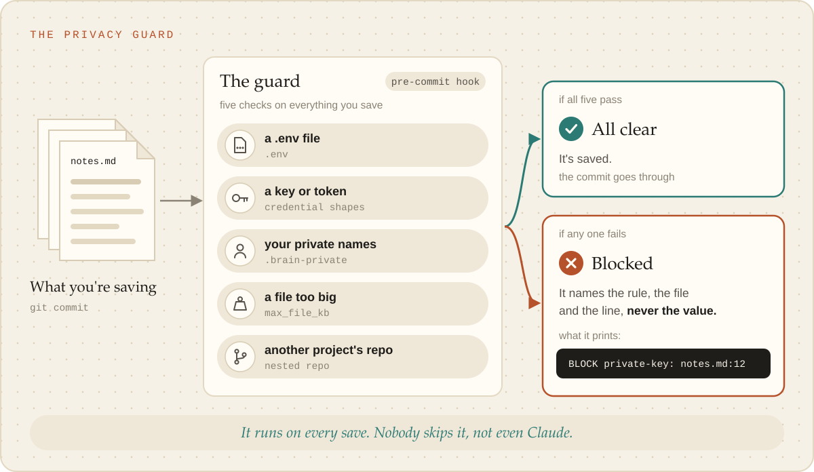

# The privacy guard

Every commit in a brain passes a pre-commit hook first. It is the only check between a secret, a private name or a
project repo and a history that may be pushed somewhere public, so it is never skipped (`--no-verify`).

<picture><source media="(prefers-color-scheme: dark)" srcset="../images/privacy-guard-dark.svg"></picture>

A pre-commit hook, installed by `new`, `adopt` and `init`, blocks a commit that stages:

- a `.env` file (other than `.env.example`);
- a credential shape: a private key header, a common token prefix, `password=` followed by a value;
- a private term from `.brain-private` (ignored): one term per line, written as a person would say
  it (a hostname, an address, a client or project name), matched in any case as a whole word; a
  line starting `re:` is a regular expression instead, and an invalid one is a BLOCK. Or a match of
  the `deny_patterns` in `brain.json`;
- a file over `max_file_kb` that is not in `large_file_allow`;
- a path inside a nested git repo.

Findings name the rule, file and line, never the value. A template file exactly as shipped (it
matches `_meta/MANIFEST.sha256`) is exempt from the private-term and deny-pattern scan, since the
person cannot edit it and template text should not block every commit; credential shapes and file
names are still checked, and an edited template file is scanned like any other.
