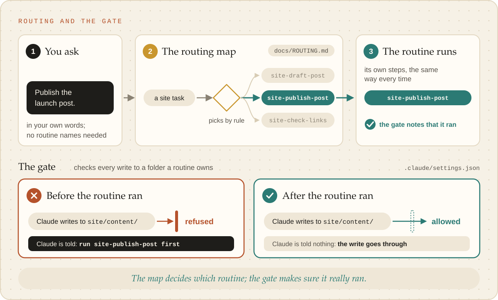

# Routing and the skill gate

Two mechanisms keep work from being improvised: a routing map that says which skill handles what, and a gate that
refuses a skill's output until that skill has actually run.

<picture><source media="(prefers-color-scheme: dark)" srcset="../images/routing-and-the-gate-dark.svg"></picture>

Routing is forced, not left to judgement. One map says which skill hands to which and every skill is
in it: a brain's own skills in `docs/ROUTING.md`, the `brain-*` skills in `_meta/ROUTING-META.md`.
A router fans an entry point out to three or more skills by rule (`_meta/brain route`), never by
reading, and `_meta/brain lint` rejects a map that breaks the rules.

**Every brain gets a skill gate.** Reading a skill is not running it, and a skill imitated from memory
skips its `references/`. The gate is a hook, wired in `.claude/settings.json`: a skill's output can
only be written after that skill ran in the session. A skill file is refused until `brain-write-skill`
has run, a script until `brain-write-script` has, and so on; a brain adds rules for its own skills.
The refusal names the skill to invoke. A one-time waiver exists (`_meta/brain gate waive`), and only
on the person's say-so. The gate is friction and visibility, not a security boundary.
