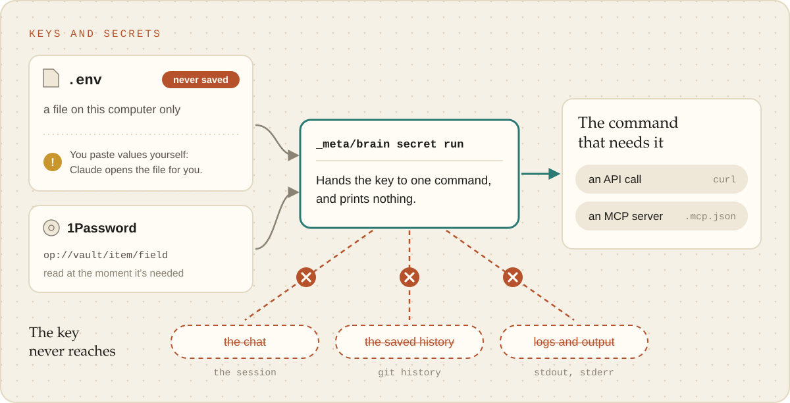

# Secrets and systems

How a brain reaches other systems without a secret ever reaching the chat, the history or a log.

<picture><source media="(prefers-color-scheme: dark)" srcset="../images/secrets-flow-dark.svg"></picture>

- **Secrets** live in `.env`, which git ignores and Claude is denied reading. A value can be the
  secret or a 1Password reference (`op://vault/item/field`, read with `op read` when needed). Names
  go in with `_meta/brain env-sync --add KEY`. Scripts read secrets through their loader; anything
  else gets them through `_meta/brain secret run KEY[,KEY] COMMAND`, which puts them in that
  command's environment and never prints one itself (a command that prints its environment
  would, so never run one).
- **MCP servers** a brain needs go in its `.mcp.json`, not in user settings, where every session
  everywhere would load their tools. A server that needs a secret runs under `secret run`.
- **Agents** (`.claude/agents/<prefix>-*.md`) are helpers a skill dispatches: explicit tools, a
  model, and a report back rather than edits. `lint` checks each one.
- **The glossary** (`docs/GLOSSARY.md`) is loaded into every session: one line per term that means
  something specific here, with the words to avoid.
- **Skill usage**: the gate logs every skill run to `.brain/skill-usage.log`, and
  `_meta/brain usage` shows which skills earn their place.
