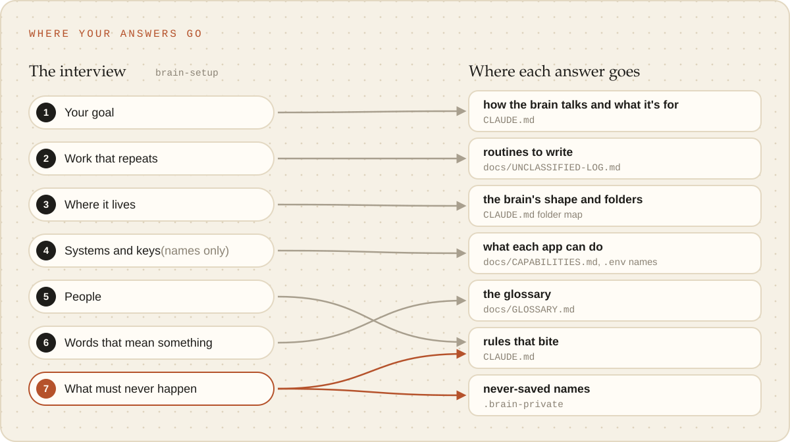

# Setting up

A **brain** is a folder you start Claude Code sessions in, whose root is a git repo holding what
Claude needs to do one kind of work well: skills, the rules that bite, what has been learned, and
small scripts. The project repos and large files the work produces sit inside the same folder but
are not part of the brain: the brain's `.gitignore` is an allowlist, so a nested repo, a generated
asset or a `.env` is never staged by accident.

A new brain has no domain skills at all. It grows through eight **meta skills** that write skills,
scripts and facts the same way every time ([Skills](skills.md)), and it pulls later improvements from
the template without merge conflicts ([Updates and upstream](updates-and-upstream.md)).

**Requirements:** Python 3.9+ (standard library only, no packages) and `git`, on macOS or Linux (on
Windows, inside WSL).

## Three ways in

All three end in the same state: the first commit made, the pre-commit guard installed,
`_meta/brain doctor` with nothing blocking, and none of the template's own files present. Each runs
with `--dry-run` first, and the skill shows the result before anything is written.

| Starting from | Say | Skill and command |
| --- | --- | --- |
| A chat in a copy of the template (GitHub "Use this template", a clone, a download) | "Set this up as a brain for X" | `brain-setup` runs `_meta/brain init` |
| A chat in the template's own checkout | "Make a brain for X at `<path>`" | `template-make-brain` runs `_meta/brain new <dir>` |
| A chat in the template's own checkout | "Turn `<folder>` into a brain" | `template-make-brain` runs `_meta/brain adopt <dir>` |

## What setup asks

Quick setup asks as little as it can: it works out the name, the prefix for the brain's own skills
(`lab` gives `lab-*`) and a one-line description from what you asked for, then asks for anything
that must never be committed (kept in `.brain-private`, which is ignored) and whether to keep the
template's guides. Everything else takes the defaults in `brain.json`.

The **interview** ("grill me") takes 10 to 15 minutes more, and the brain starts out knowing your
goals, the work that recurs, where it lives, your systems, the people involved, your words and what
must never happen. Each answer lands where it belongs, through the skill that owns it: `CLAUDE.md`,
the glossary, the capabilities file, the unclassified log. Either way, setup picks the brain's
**shape**: one project, several, a massive brain, or a hub of brains (see the
[guides](../guides/choosing-a-shape.md)).

<picture><source media="(prefers-color-scheme: dark)" srcset="../images/interview-answers-dark.svg"></picture>

## What each command guarantees

- **`new`** builds the whole brain, first commit included, in a temporary folder beside the target
  and moves it into place only when that succeeded, so a failed `new` leaves nothing behind.
  `--dry-run` rehearses the real build and discards it.
- **`adopt`** never moves, renames, overwrites or deletes a file already in the folder. It prints an
  inventory (nested repos at any depth, large folders, existing skills, `CLAUDE.md`, `.env`), adds
  the brain files and the managed blocks (marked regions at the top of `CLAUDE.md` and `.gitignore`
  that the template owns and refreshes, with the brain's own lines below), and stops before
  committing. It shows what `git add -A` would stage, with a BLOCK or WARN line for anything that
  needs a decision (an embedded repo, a tracked `.env`); the first commit is made once those are
  resolved and the person says yes.
- **`init`** refuses anything but an unchanged copy of the template (and refuses where a `local/`
  folder exists, which is how it never converts the template itself). It removes everything that
  is only for developing the template: its README, tests, docs and GitHub files. `--keep-guides`
  keeps `docs/guides/`, `docs/images/` and `docs/reference/`, listed in the brain's
  `docs/README.md`, until the person asks for them to go. A plain clone gets a fresh history, only
  when every commit is on its remote. A clone of a local checkout tracks the template's canonical
  source and keeps the local path in `brain.local.json`, which is ignored.

Before publishing a template of your own, set `template.source` in its `brain.json` to the published
URL, so `init` in a clone of it starts a fresh history and never keeps the template as `origin`.

## Then: open Claude Code at the brain's root

The `.env` deny, the skill gate and the brain's MCP servers are read from `.claude/settings.json` and
`.mcp.json` there, and only there ([What loads where](what-loads-where.md)). Each session starts with
`_meta/brain doctor --brief`, a hook that prints only what needs attention, so a brain that is behind
its template, has unpushed work or has hand-offs waiting says so before the work begins.
