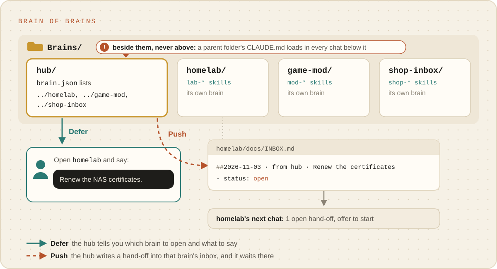

# Several brains

Brains are separate repos that never write into each other, with one exception: a **hand-off**, a
request one brain leaves in another's inbox. A brain that knows the others and routes work to them
is a **hub** (the guide: [Brain of brains](../guides/brain-of-brains.md)).

<p align="center"><picture><source media="(prefers-color-scheme: dark)" srcset="../images/brain-of-brains-dark.svg"></picture></p>

## Where a hub lives

Beside the brains it knows, never above them:

```
Brains/
├─ hub/          brain.json: "brains": ["../homelab", "../game-mod"]
├─ homelab/
└─ game-mod/
```

Claude Code loads `CLAUDE.md` from a chat's folder and every folder above it, so a hub that held the
other brains would load into every chat in them ([What loads where](what-loads-where.md)).

## The list

`brain.json` `brains` lists the folders of the brains a hub knows, relative to the hub (or starting
with `~`), so the list reads the same on any computer with the same layout.

- `_meta/brain brains add ../homelab` checks the folder holds a brain (a `brain.json` whose `role`
  is `brain`) before adding it.
- `_meta/brain brains list` prints each one's name, folder, skill prefix, description and open
  hand-offs, read from its own `brain.json` and inbox.
- `doctor` warns when a listed folder no longer holds a brain.

## Hand-offs and the inbox

```bash
_meta/brain brains handoff homelab --title "Renew the NAS certificates" \
  --body "They expire on Friday. The renewal steps are in practice nas-certs."
```

appends an entry to `homelab/docs/INBOX.md`:

```markdown
## 2026-11-03 · from hub · Renew the NAS certificates
- status: open

They expire on Friday. The renewal steps are in practice nas-certs.
```

It writes that one file (never through a link), and commits nothing: the receiving brain's next
chat is told about it, because `doctor --brief` (the session-start check) warns about every open
entry. That brain works the entry through its own routing map, under its own gate and settings, then
sets the status to `done` or `declined: <reason>` and commits through `brain-sync`.

Every brain has `docs/INBOX.md` from its skeleton; an older brain gets one on its first hand-off.
Setup uses the same inbox: interview findings not yet worked through wait there as one entry.

## Defer or push

A hub's routing skill (`<prefix>-route-work`, written through `brain-write-skill`) picks the brain
for a piece of work from `brains list`, each brain's `README.md` and the entry points of its routing
map. Then it either:

- **defers**: tells the person which brain to open and exactly what to say there, or
- **pushes**: queues the work with `brains handoff`, with everything already known in the body.

It never does another brain's work itself: that brain's gate, settings and MCP servers do not load in
the hub.
