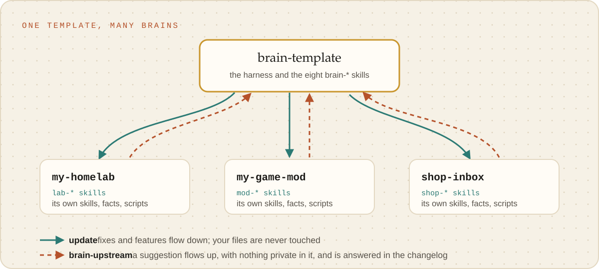

# Updates and upstream

A brain and its template improve each other without either writing into the other: the template's changes come down
through `update`, and a brain's ideas go up as suggestions the template answers.

<picture><source media="(prefers-color-scheme: dark)" srcset="../images/template-and-brains-dark.svg"></picture>

## Keeping a brain current

`_meta/brain update` pulls the template's **committed** history (never its working tree, so
uncommitted template edits do not reach a brain) and replaces the files the template owns: `_meta/`,
the `brain-*` skills, and the managed blocks in `CLAUDE.md` and `.gitignore`. It also refreshes the
template's gate and `.env` entries in `.claude/settings.json` and the version in `brain.json`; every
other entry is left alone, and so is everything else in the brain. It refuses, rather than merges,
when a template-owned file was edited in the brain; it prints the changelog entries it brings and
does not commit, `brain-sync` does.

## Sending a change upstream

A brain never edits a template-owned file, and the template never writes into a brain. They exchange
suggestions by reading each other:

1. In the brain, `brain-upstream` records one proposed change in `docs/UPSTREAM.md`, written so it
   holds nothing private to that brain.
2. In the template, `template-intake` reads the open suggestions from the brains listed in
   `local/brains.txt`, accepts or declines each with the person, makes an accepted change, and
   answers every one in `_meta/CHANGELOG.md` by id. Committing is enough; there is no
   release step.
3. In the brain, the next `update` reports the answered ids, and `brain-sync` marks each one landed
   or declined.
