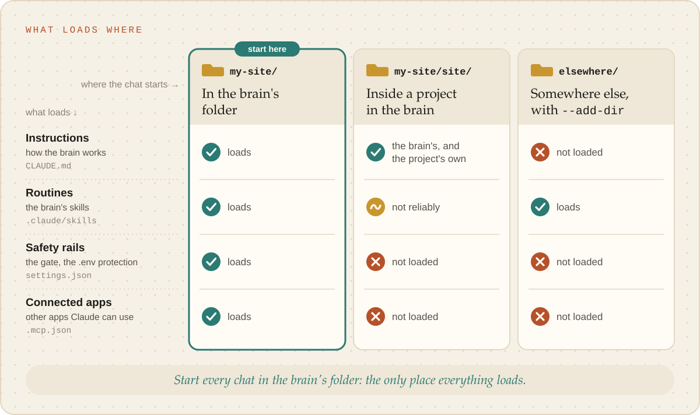

# What loads where

Claude Code decides what to load from the folder a chat **starts** in. That one fact shapes every
brain's layout, so it is worth knowing exactly. (From the Claude Code documentation on
[memory](https://code.claude.com/docs/en/memory.md), [skills](https://code.claude.com/docs/en/skills.md),
[settings](https://code.claude.com/docs/en/settings.md) and
[large codebases](https://code.claude.com/docs/en/large-codebases.md).)

<picture><source media="(prefers-color-scheme: dark)" srcset="../images/what-loads-where-dark.svg"></picture>

| What | Chat at the brain's root | Chat inside a project in the brain (`repos/api/`) | Chat elsewhere, with `--add-dir <brain>` |
| --- | --- | --- | --- |
| The brain's `CLAUDE.md` | yes | yes: `CLAUDE.md` loads from the start folder **and every folder above it** | only with `CLAUDE_CODE_ADDITIONAL_DIRECTORIES_CLAUDE_MD=1` |
| The project's own `CLAUDE.md` | when Claude works in its files | yes | no |
| The brain's skills | yes | not reliably: skills are read up to the repository root, and the project is its own repository | yes |
| `.claude/settings.json`: the skill gate, the `.env` deny, the session-start check | yes | **no**: settings are read from the start folder only | no |
| `.mcp.json`: the brain's MCP servers | yes | no | no |

So:

- **Start every chat at the brain's root.** It is the only place where everything loads, the safety
  rails included.
- A project inside the brain gets the brain's `CLAUDE.md` for free, which is useful for a quick
  question, but none of its rails.
- **Never put a brain inside another brain.** The inner one would load the outer one's `CLAUDE.md`
  in every chat. A hub sits *beside* the brains it knows ([Several brains](several-brains.md)).
- `--add-dir` brings a brain's skills into a chat started somewhere else, without its gate, settings
  or MCP servers. Fine for a read-only question; not for work the gate should guard.
- A skill copied into `~/.claude/skills` runs in every chat on the computer, without the brain's
  conventions. Keep a brain's skills in the brain.
- `claudeMdExcludes` (a setting) skips named `CLAUDE.md` files, if a layout ever needs it.
