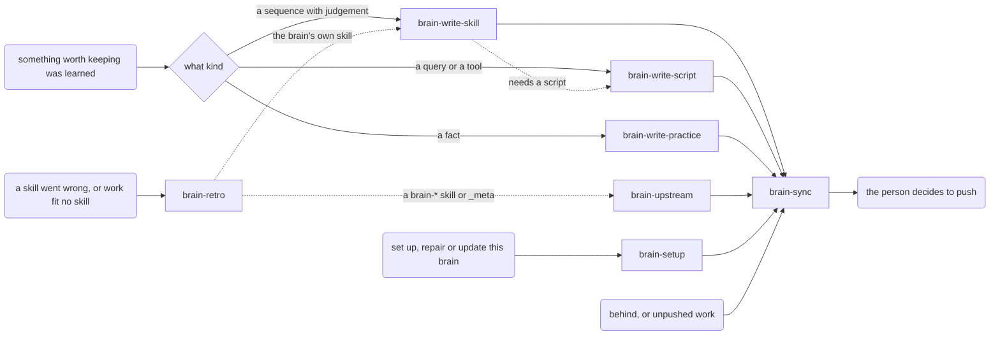

# Brain Template Implementation Plan

> **For agentic workers:** REQUIRED SUB-SKILL: Use superpowers:subagent-driven-development (recommended) or superpowers:executing-plans to implement this plan task-by-task. Steps use checkbox (`- [ ]`) syntax for tracking.

**Goal:** Build the brain template: a stdlib-Python harness (`_meta/brain`), a skeleton, seven shipped `brain-*` meta skills and two template-only skills, so a person can make, adopt or set up a brain whose skills, scripts and facts grow through forced, repeatable routing.

**Architecture:** One executable `_meta/brain` dispatches to small single-purpose modules in `_meta/brainlib/`, each imported only when its subcommand runs (the gate runs on every tool call, so start-up must stay cheap). Lifecycle commands copy shipped files from the template's committed history and record a hash manifest; checks (`lint`, `doctor`, pre-commit, gate) read the same config loader and report in one line format. Skills are Markdown under `.claude/skills/`, drawn in a Mermaid routing map that the harness parses, lints and turns into each skill's "Where this sits" block.

**Tech Stack:** Python 3.9+ standard library, `git`, `unittest`, Markdown/Mermaid, Claude Code hooks and skills.

**Spec:** `docs/superpowers/specs/2026-11-02-brain-template-design.md` (approved 2026-11-02). Section references below (§n) point into it.

## Global Constraints

- Python 3.9+ standard library only. Every module starts with `from __future__ import annotations`. A test parses every harness file with `ast.parse(src, feature_version=(3, 9))`.
- Linux and macOS: the only external program is `git`; no GNU-only flags; file operations in Python.
- Every git call goes through `gitutil.git()`, which runs `["git", "--no-optional-locks", ...]` as an argument list, never a shell string. Read-only commands must leave nested repos' `.git/index` untouched.
- Writes only inside the target brain, OS temp directories, the brain's git hooks directory, and the template's `local/brains.txt` (`new`, `adopt`).
- Never print a secret value. Findings name the rule, file and line only.
- Exit codes: 0 success or nothing blocking; 1 blocking finding or refusal; 2 usage error.
- Report lines are `f"{severity:<6} {subject}: {message}"` with severities `ok`, `WARN`, `BLOCK`, `BROKEN`, `GAP`, `ORPHAN`.
- `gate check` always exits 0, never emits `"permissionDecision": "allow"` (it must never bypass the person's permission prompt), and on its own error prints `{"systemMessage": "skill gate error (write allowed): …"}`.
- Pinned strings: Markdown markers `<!-- brain:begin — managed by the brain template; edit below the end marker -->` / `<!-- brain:end -->`; gitignore markers `# <!-- brain:begin --> managed by the brain template; edit below the end marker` / `# <!-- brain:end -->`; first commit `meta(brain): initialise from template v<version>`; prefix regex `^[a-z][a-z0-9]{1,15}$`; refused prefixes `brain`, `template`.
- `_meta/brain` sets `sys.dont_write_bytecode = True`. The managed gitignore block also ignores `__pycache__/` and `*.pyc` (builder addition to §4's block).
- Skeleton files that are dotfiles or live under `.claude/` are stored renamed (`gitignore`, `env.example`, `claude-settings.json`) and renamed on copy, so they never act on the template repo itself.
- The template's own `.claude/settings.json`, which wires the gate, is written in Task 20, last, so the gate never blocks building the skills it protects.
- Tests run as `PYTHONDONTWRITEBYTECODE=1 python3 -m unittest discover -s tests -t . -v` from the template root. Every test works inside a temporary directory whose path contains a space, and never reads the person's global git config.
- No tracked file contains a term from `local/origin-terms.txt` (ignored) or an absolute home path.
- Commits: at least one per task, subject `meta(<area>): …`, `skill(<name>): …`, `docs(<area>): …` or `test(<area>): …`, body ending `Co-Authored-By: Claude Opus 5.5 <noreply@anthropic.com>`. Never push.

## Review Focus

1. **Paths with spaces.** The template lives in a folder with a space and so may a brain. Every subprocess call, the pre-commit shim and the settings hook command must quote or pass paths as arguments. Pinned by the helpers' `with space` temp root (Task 1), `test_shim_works_in_path_with_space` (Task 8) and `test_hook_command_is_quoted` (Task 9).
2. **A secret echoed in a finding.** The guard is useless if its own output leaks the value to a terminal or log. Pinned by `test_findings_never_echo_secret` (Task 8).
3. **Unusual gate input.** Malformed JSON, missing fields, absolute paths, `..` segments and paths outside the brain must neither crash the hook nor open a hole. Pinned by `test_malformed_payload_fails_open` and `test_path_normalisation` (Task 5).
4. **A fresh brain with no script tests.** Python 3.12+ `unittest discover` exits 5 when it finds nothing, which would make `doctor` block every new brain. Pinned by `test_fresh_brain_full_doctor_has_no_block` (Task 14).
5. **Binary or non-UTF-8 staged files.** An image or a Latin-1 file in `docs/` must not crash the pre-commit hook and so block every commit. Pinned by `test_binary_and_latin1_files_do_not_crash` (Task 8).

---

## File Structure

```text
.gitignore  brain.json  README.md  CLAUDE.md  .claude/settings.json      template-only (Tasks 1, 20)
_meta/
  brain                       entry point: sys.path + brainlib.cli.main
  VERSION  CHANGELOG.md        0.1.0; one entry per version (Task 1, 20)
  gates.json                  shipped gate rules (Task 5)
  ROUTING-META.md             routing map of brain-* skills (Task 19)
  managed/CLAUDE.block.md     managed CLAUDE.md block body (Task 9)
  managed/gitignore.block     managed .gitignore block body (Task 9)
  skeleton/                   brain-owned starter files (Tasks 7, 9)
  brainlib/
    cli.py        subcommand registry and dispatch            (1)
    paths.py      harness_root()                              (1)
    config.py     Config, load(), validate_prefix()           (1)
    report.py     Finding, emit(), exit_code()                (1)
    skills.py     Skill, parse_frontmatter(), list_skills()   (2)
    lint.py       lint_skills(), run()                        (2)
    routing.py    map parser, graph, lint_routing(), show     (3)
    route.py      router rules engine                         (4)
    globs.py      match()                                     (5)
    gate.py       skill gate                                  (5)
    routing_sync.py  "Where this sits" blocks, class styles   (6)
    practices.py  practices store                             (7)
    gitutil.py    git(), staged(), nested_repos(), archive()  (8)
    hook.py       pre-commit guard, install, self-test        (8)
    managed.py    managed blocks, settings merge              (9)
    manifest.py   shipped set, MANIFEST.sha256                (9)
    install.py    shared copy/write/commit steps              (10)
    cmd_new.py  cmd_adopt.py  inventory.py  cmd_init.py       (10–12)
    changelog.py  upstream.py  cmd_update.py                  (13)
    doctor.py                                                 (14)
    rename.py  envsync.py                                     (15)
.claude/skills/brain-*/       shipped meta skills (16–19)
.claude/skills/template-*/    template-only skills (19)
docs/README.md  docs/ROUTING.md                               template's own (19, 20)
tests/                        __init__.py, .brain-template, helpers.py, fixtures.py, test_*.py, scenarios/
```

Each `brainlib` command module exposes `add_arguments(parser: argparse.ArgumentParser) -> None` and `run(args: argparse.Namespace) -> int`, and registers one line in `cli.COMMANDS`.

---

### Task 1: Repository, CLI dispatcher, config, test helpers

**Files:**
- Create: `.gitignore`, `brain.json`, `_meta/brain`, `_meta/VERSION`, `_meta/CHANGELOG.md`, `_meta/brainlib/__init__.py`, `_meta/brainlib/{paths,config,report,cli}.py`, `tests/__init__.py`, `tests/.brain-template`, `tests/helpers.py`, `tests/test_cli.py`, `tests/test_config.py`
- Modify: spec line 3 to `**Status:** approved, 2026-11-02.`

**Interfaces:**
- Produces:
  - `paths.harness_root() -> Path` (the folder that contains this `_meta/`)
  - `config.Config` dataclass: `root: Path, name: str, prefix: str, role: str ("brain"|"template"), description: str, template_source: str|None, template_version: str|None, python: str, packages: str, deny_patterns: list[str], private_patterns: list[str], private_file_expected: bool, max_file_kb: int, large_file_allow: list[str], stale_after_days: int, gates: list[dict], gates_off: list[dict], gate_exempt: list[str], raw: dict`
  - `config.load(root: Path) -> Config` (raises `config.ConfigError`); `config.read_raw(root) -> dict`; `config.write_raw(root, raw: dict) -> None` (indent 2, key order kept, trailing newline); `config.validate_prefix(p: str) -> str|None` (error message or None); `config.effective_source(cfg: Config) -> str|None` (`brain.local.json` `template.source` wins)
  - `report.Finding(severity, subject, message)` (frozen dataclass); constants `OK WARN BLOCK BROKEN GAP ORPHAN`; `report.emit(findings, out=sys.stdout) -> None`; `report.exit_code(findings, failing=(BLOCK, BROKEN)) -> int`
  - `cli.COMMANDS: dict[str, tuple[str, str]]` (name → (module, help)); `cli.main(argv: list[str]) -> int`
  - `tests/helpers.py`: `TEMPLATE_ROOT`; `class TempDirCase(unittest.TestCase)` with `self.tmp` (a `with space` dir), `self.env` (git identity `Brain Test <test@example.invalid>`, `GIT_CONFIG_GLOBAL` = empty temp file, `GIT_CONFIG_NOSYSTEM=1`, `PYTHONDONTWRITEBYTECODE=1`, `TMPDIR` = `self.tmp/"os-tmp"`), and methods `run_brain(root, *args, stdin=None, cwd=None) -> CompletedProcess`, `git(cwd, *args) -> str`, `fake_brain(prefix="lab", role=None, extra=None) -> Path` (copies `_meta/` from the working tree, writes `brain.json`), `copy_template(with_local=True) -> Path` (copies the working tree minus `.git`, `local`, `__pycache__`, `git init -b main`, commits, then creates `local/`), `make_skill(root, name, description, body) -> Path`, `snapshot(path) -> dict[str, tuple[int, int]]` (relpath → size, mtime_ns, `.git` contents included)

- [ ] **Step 1: Initialise the repo and template files**

`git init`, `git symbolic-ref HEAD refs/heads/main`. `.gitignore`:

```gitignore
/*
!/.gitignore
!/brain.json
!/CLAUDE.md
!/README.md
!/.claude/
!/_meta/
!/tests/
!/docs/
__pycache__/
*.pyc
/.claude/settings.local.json
```

`brain.json`: `{"name": "brain-template", "prefix": "template", "role": "template", "description": "The template every brain is made from", "template": {"source": null, "version": null}, "scripts": {"python": "python3", "packages": "stdlib-only"}, "privacy": {"deny_patterns": [], "max_file_kb": 1024, "large_file_allow": []}, "practices": {"stale_after_days": 180}, "gates": [], "gates_off": [], "gate_exempt": []}`. `_meta/VERSION`: `0.1.0`. `_meta/CHANGELOG.md`: `# Changelog` then `## 0.1.0 — 2026-11-02` with one line `- First version.` `tests/.brain-template`: empty marker that `doctor` looks for.

- [ ] **Step 2: Write the failing tests**

```python
class CliTest(TempDirCase):
    def test_version(self):
        r = self.run_brain(TEMPLATE_ROOT, "--version")
        self.assertEqual((r.returncode, r.stdout.strip()), (0, "brain 0.1.0"))
    def test_unknown_command_is_usage_error(self):
        self.assertEqual(self.run_brain(TEMPLATE_ROOT, "nope").returncode, 2)
    def test_harness_parses_as_python_3_9(self):
        for p in [*(TEMPLATE_ROOT / "_meta").rglob("*.py"), TEMPLATE_ROOT / "_meta" / "brain"]:
            ast.parse(p.read_text(), filename=str(p), feature_version=(3, 9))
    def test_stdlib_only(self):  # every import's top-level name is in sys.stdlib_module_names or "brainlib"
        ...

class ConfigTest(TempDirCase):
    def test_defaults(self):
        cfg = config.load(self.fake_brain())
        self.assertEqual((cfg.role, cfg.max_file_kb, cfg.stale_after_days, cfg.python, cfg.packages, cfg.gates),
                         ("brain", 1024, 180, "python3", "stdlib-only", []))
    def test_private_patterns(self):  # .brain-private "castle-black\n# note\n\n" -> ["castle-black"]
    def test_local_json_overrides_source(self):  # brain.local.json source "/x" -> effective_source == "/x"
    def test_prefix_validation(self):
        self.assertIsNone(config.validate_prefix("lab"))
        for bad in ("brain", "template", "Lab", "l", "x" * 17, "9ab", "la-b"):
            self.assertIsNotNone(config.validate_prefix(bad))
    def test_missing_brain_json(self):  # raises ConfigError
```

- [ ] **Step 3: Run them to make sure they fail**

Run: `PYTHONDONTWRITEBYTECODE=1 python3 -m unittest tests.test_cli tests.test_config -v`
Expected: FAIL (`_meta/brain` and `brainlib` missing).

- [ ] **Step 4: Implement**

`_meta/brain`: `#!/usr/bin/env python3`, `sys.dont_write_bytecode = True`, insert `os.path.dirname(os.path.realpath(__file__))` into `sys.path`, `sys.exit(brainlib.cli.main(sys.argv[1:]))`; mode 0755. `cli.main` builds `argparse.ArgumentParser(prog="brain")` with `--version` (reads `_meta/VERSION`) and one subparser per `COMMANDS` entry, importing `brainlib.<module>` only for the chosen command. `COMMANDS` starts empty. `config.load` fills defaults for every absent key (§4); `role` defaults to `"brain"`.

- [ ] **Step 5: Run the tests to verify they pass**, then edit the spec status line.

- [ ] **Step 6: Commit**

```bash
git add -A && git commit -m "meta(cli): scaffold the harness, config loader and test helpers"
```

---

### Task 2: Skill parsing and `lint`

**Files:**
- Create: `_meta/brainlib/skills.py`, `_meta/brainlib/lint.py`, `tests/test_lint.py`
- Modify: `cli.COMMANDS` (`"lint": ("lint", "check skills and the routing map")`)

**Interfaces:**
- Consumes: `config.load`, `report.*`
- Produces:
  - `skills.Skill(name: str, folder: Path, path: Path, meta: dict[str, str], body: str)`
  - `skills.parse_frontmatter(text: str) -> tuple[dict[str, str], str]` (single-line `key: value`, optional quotes; `[a, b]` kept as raw string)
  - `skills.list_skills(root: Path) -> list[Skill]` (folders in `.claude/skills/` holding `SKILL.md`, sorted)
  - `skills.deep_skill_files(root: Path) -> list[Path]` (`SKILL.md` deeper than one level)
  - `skills.skill_prefixes(cfg: Config) -> set[str]` (`{"brain", cfg.prefix}`, plus `"template"` when `cfg.role == "template"`)
  - `skills.named_skills(text: str, prefixes: set[str]) -> list[str]` (tokens `<prefix>-word(-word)*`)
  - `skills.owned_skills(cfg, all_skills) -> list[Skill]` (the skills this brain's `routing sync` writes: in a brain, those not starting `brain-`; in the template, all)
  - `lint.lint_skills(root: Path, cfg: Config) -> list[Finding]`; `lint.EXTRA_CHECKS: list[Callable[[Path, Config, list[Skill]], list[Finding]]]` (later tasks append routing, route and gate checks); `lint.run(args) -> int` prints findings then `lint: <n> broken, <n> gap, <n> orphan`

- [ ] **Step 1: Write the failing tests** (`tests/test_lint.py`, each building a `fake_brain` with `make_skill`)

```python
def test_clean_skill_has_no_findings(self):
    # lab-a: description "Does X. Use when Y. Does NOT do Z, which is lab-b.", body cites references/r.md
    # (exists) and has "## Done when"; lab-b likewise -> lint_skills(...) == []
def test_broken_cases(self):  # subTest each -> one BROKEN naming the skill
    # missing name; missing description; name != folder; two folders with the same frontmatter name;
    # .claude/skills/lab-a/sub/SKILL.md; description of 1025 chars; cites references/missing.md;
    # Does NOT names lab-ghost
def test_cited_path_found_at_brain_root_is_fine(self):  # cites scripts/common/x.py existing at root
def test_placeholder_paths_not_checked(self):  # "scripts/<system>/" -> no BROKEN
def test_gap_cases(self):  # no "Does NOT"; no "## Done when"; body of 151 lines; skill "other-x" in a lab brain
def test_orphan_reference(self):  # references/unused.md never cited -> ORPHAN
def test_template_tokens_ignored_in_brain(self):  # "Does NOT …, which is template-intake" in a brain -> no BROKEN
def test_adopted_style_skill_gaps_not_broken(self):  # "se2-idea": name + description only, no Does NOT,
    # no Done when, 200-line body, in a "lab" brain -> only GAP findings, lint exit 0
def test_exit_codes_and_summary(self):  # BROKEN -> exit 1; GAP only -> exit 0; last line "lint: 0 broken, 1 gap, 0 orphan"
```

- [ ] **Step 2: Run to verify failure:** `PYTHONDONTWRITEBYTECODE=1 python3 -m unittest tests.test_lint -v` → FAIL (no `skills` module).

- [ ] **Step 3: Implement** per §7.2. Cited paths: regex `(?<![\w/.-])(?:references|scripts)/[A-Za-z0-9_./-]+`, strip trailing `.,)`; a path is BROKEN only if it exists neither relative to the skill folder nor relative to the brain root (builder call: §7.2 says skill folder; root fallback stops false alarms on `scripts/<system>/` prose). "Does NOT" names: `named_skills` on the description text after the first `Does NOT`/`does NOT`. GAP for a missing sibling: no `Does NOT` or no named skill after it. Body length counts lines after frontmatter.

- [ ] **Step 4: Run to verify pass.**

- [ ] **Step 5: Commit** `meta(lint): check skills for broken references, gaps and orphans`

---

### Task 3: Routing map: parse, lint, show

**Files:**
- Create: `_meta/brainlib/routing.py`, `tests/test_routing.py`
- Modify: `cli.COMMANDS` (`"routing": ("routing", "routing map tools")` with sub-subcommand `show [SKILL]`); `lint.EXTRA_CHECKS` gains `routing.lint_routing`

**Interfaces:**
- Produces:
  - `routing.CLASSES = ("entry", "gate", "work", "optional", "decision", "state", "human")`
  - `routing.Node(id, cls, label, file, line)`, `routing.Edge(src, dst, sometimes: bool, label: str, file, line)`, `routing.Graph(nodes: dict[str, Node], edges: list[Edge], not_drawn: dict[str, str], problems: list[Finding])`
  - `routing.parse(text: str, file: str, graph: Graph) -> None`
  - `routing.load_graph(root: Path) -> Graph` (reads `_meta/ROUTING-META.md` then `docs/ROUTING.md`; a missing file is empty)
  - `routing.is_skill_id(node_id: str) -> bool` (first character lowercase)
  - `routing.contract(graph) -> tuple[dict[str, set[str]], dict[str, set[str]]]` (up, down, skill to skill, walking through non-skill nodes)
  - `routing.reachable(graph) -> set[str]` (node ids reachable from `entry` nodes)
  - `routing.lint_routing(root, cfg, skills: list[Skill]) -> list[Finding]`
  - `routing.show(root: Path, skill: str|None) -> str`

**Dialect (pinned, §7.7):** only ```` ```mermaid ```` fences outside `<!-- … -->` comments are read. Allowed lines in a fence: blank; `%%` comments; `flowchart <DIR>` or `graph <DIR>`; `classDef …`; a node statement; an edge statement. Node reference: id `[A-Za-z][A-Za-z0-9_-]*`, optional shape `[…]`, `(…)`, `{…}`, `[(…)]`, `((…))`, `{{…}}`, `[[…]]` (quoted `"…"` label text may contain brackets), optional `:::class`. Edge statement: `ref (ARROW [|label|] ref)+` with ARROW `-->` (call) or `-.->` (sometimes). Anything else is `BROKEN unsupported line` with file and line. `## Not drawn` is a Markdown table of `` `skill` `` and reason in `docs/ROUTING.md`.

- [ ] **Step 1: Write the failing tests**

```python
def test_parse_nodes_classes_edges(self):  # labels containing ']' inside quotes; -.-> sets sometimes=True
def test_contract_walks_through_decisions(self):
    # IN(x):::entry --> lab-router:::work ; lab-router --> KIND{kind}:::decision ; KIND -->|a| lab-a:::work ...
    up, down = routing.contract(g)
    self.assertEqual(down["lab-router"], {"lab-a", "lab-b", "lab-c"}); self.assertEqual(up["lab-a"], {"lab-router"})
def test_same_id_across_diagrams_joins(self):  # entry in fence 1, skill reached only via fence 2
def test_meta_and_brain_files_share_ids(self):  # META declares brain-retro:::work; docs uses lab-x --> brain-retro
def test_lint_broken(self):  # subTest: ghost lowercase node; node never given a class; :::foo; conflicting
                             # classes; "A -- text --> B"; a fence inside an HTML comment is ignored (no finding)
def test_lint_gap(self):  # undrawn skill; skill unreachable from entry; skill in Not drawn -> no GAP
def test_call_directly_line(self):  # owned skill without "**Call it directly when:**" -> GAP; line reading TODO -> GAP
def test_show(self):  # "routing show lab-router" prints "down: lab-a, lab-b, lab-c" and "up: (entry)"
```

- [ ] **Step 2: Run to verify failure** (`tests.test_routing`).
- [ ] **Step 3: Implement** a hand-written scanner for node references (not one regex), then the checks in §7.7. GAP checks for undrawn, unreachable and the call line apply to `skills.owned_skills`.
- [ ] **Step 4: Run to verify pass**, plus `tests.test_lint`.
- [ ] **Step 5: Commit** `meta(routing): parse, lint and show the routing map`

---

### Task 4: Router rules engine `route`

**Files:**
- Create: `_meta/brainlib/route.py`, `tests/test_route.py`
- Modify: `cli.COMMANDS` (`"route"`); `lint.EXTRA_CHECKS` gains `route.lint_rules`

**Interfaces:**
- Produces:
  - `route.load_rules(path: Path) -> dict`
  - `route.route(rules: dict, inputs: dict[str, list[str]]) -> dict` returning `{"skill": str, "rule": int|"default", "also": list[str], "why": str}` (`rule` is 1-based)
  - `route.check_rules(rules: dict, skill_names: set[str]) -> list[str]`
  - `route.router_files(root) -> list[Path]` (`.claude/skills/*/rules.json`)
  - `route.lint_rules(root, cfg, skills) -> list[Finding]` (BROKEN per `check_rules` message)
  - CLI: `route RULES [--set FIELD=VALUE]... [--check]`; `RULES` is a path, or a router name resolved to `.claude/skills/<name>/rules.json`; prints the result as one JSON line

**Semantics (pinned, §7.8):** first match wins; a rule matches when every condition holds; a condition `field: [values]` holds when any input value for `field` equals any listed value, compared case-insensitively after stripping; `field~` holds on a case-insensitive substring; a field absent from the input fails its condition; repeated `--set kind=a --set kind=b` gives `kind` two values; no match gives `default`, which is `"brain-retro"` when the key is absent. `check_rules` errors: not an object; `rules` not a list; a rule without `when` (object), `skill` or `why`; `also` not a list; a skill (rule, `also`, `default`, case `expect`) that does not exist; a case whose result differs from `expect` (message names the case index, got and expected).

- [ ] **Step 1: Write the failing tests**: `test_first_match_wins`, `test_all_conditions_must_hold`, `test_case_insensitive_exact`, `test_tilde_substring`, `test_repeated_set_any_match`, `test_missing_field_fails`, `test_default_and_fallback_to_brain_retro`, `test_cli_prints_json` (keys `skill rule also why`), `test_check_reports_missing_skill_failing_case_and_missing_why` (exit 1), `test_router_name_resolves`, `test_lint_includes_rules_errors`.
- [ ] **Step 2: Run to verify failure** (`tests.test_route`).
- [ ] **Step 3: Implement.**
- [ ] **Step 4: Run to verify pass.**
- [ ] **Step 5: Commit** `meta(route): add the router rules engine`

---

### Task 5: Glob matching and the skill gate

**Files:**
- Create: `_meta/brainlib/globs.py`, `_meta/brainlib/gate.py`, `_meta/gates.json`, `tests/test_globs.py`, `tests/test_gate.py`
- Modify: `cli.COMMANDS` (`"gate"` with `record`, `check`, `waive SKILL REASON`, `status [--session ID]`); `lint.EXTRA_CHECKS` gains `gate.lint_rules`

**Interfaces:**
- Produces:
  - `globs.match(pattern: str, relpath: str) -> bool` (anchored; `*` and `?` never cross `/`; `**` crosses; `a/**` matches everything below `a/`)
  - `gate.Rule(path: str, skills: list[str], spend_on_revision: bool, why: str, shipped: bool)`
  - `gate.load_rules(root, cfg) -> tuple[list[Rule], list[str]]` (rules, exempt globs): `_meta/gates.json` rules with `{prefix}` replaced, `only_in` filtered by `cfg.role`, minus any whose `path` is in `cfg.gates_off`; then `cfg.gates`; exempt = `gates.json` `exempt` + `cfg.gate_exempt`
  - `gate.lint_rules(root, cfg, skills) -> list[Finding]` (BROKEN: a rule naming a missing skill; a `gates_off` entry without `why`)
  - `gate.bash_targets(command: str) -> list[str]` (targets of `>`, `>>`, `tee [-a]`, last argument of `cp`, `mv`, `sed -i`; quotes stripped; uses `shlex` with a fallback split)
  - `gate.targets(payload: dict, root: Path) -> list[tuple[str, bool]]` (relpath inside root, exists); reads `tool_input.file_path`, `tool_input.notebook_path`, or `bash_targets(tool_input.command)`, resolved against `payload["cwd"]` then normalised; paths outside root are dropped
  - `gate.record(root, payload) -> None`; `gate.check(root, payload) -> dict|None`; `gate.waive(root, skill, reason) -> str`; `gate.status(root, session_id) -> dict` (`ran`, `waiver`, `last_refusal`)
  - State file: `Path(tempfile.gettempdir()) / "brain-gate" / sha1(str(root))[:12] / f"{session_id}.json"` holding `{"ran": {skill: count}, "last_refusal": {...}|null}`. Waiver: `<root>/.brain/gate-waiver.json`; log: `<root>/.brain/gate-waivers.log`, tab-separated `ISO-time  armed|used  skill  reason  path`.

`_meta/gates.json` (pinned):

```json
{
  "rules": [
    {"path": ".claude/skills/{prefix}-*/**", "skills": ["brain-write-skill"], "why": "Skills are written through brain-write-skill, so they land in the routing map and pass lint."},
    {"path": ".claude/skills/brain-*/**", "skills": ["brain-write-skill"], "only_in": "template", "why": "Shipped skills are written through brain-write-skill."},
    {"path": "docs/ROUTING.md", "skills": ["brain-write-skill"], "why": "The routing map changes when a skill is placed, through brain-write-skill."},
    {"path": "scripts/**", "skills": ["brain-write-script"], "why": "Scripts follow brain-write-script: placement, read-only by default, tests."},
    {"path": "docs/CAPABILITIES.md", "skills": ["brain-write-script"], "why": "Capabilities are recorded from a probe, through brain-write-script."},
    {"path": "docs/practices/**", "skills": ["brain-write-practice"], "why": "Practices need evidence, a duplicate check and the index, through brain-write-practice."},
    {"path": "docs/RETRO-LOG.md", "skills": ["brain-retro"], "why": "Retro rows come with a proposed fix, through brain-retro."},
    {"path": "docs/UNCLASSIFIED-LOG.md", "skills": ["brain-retro"], "why": "Unclassified rows say what a skill would need, through brain-retro."},
    {"path": "docs/UPSTREAM.md", "skills": ["brain-upstream", "brain-sync"], "why": "Upstream suggestions are written without private details, through brain-upstream."}
  ],
  "exempt": []
}
```

**Hook output (pinned):** refusal → `{"hookSpecificOutput": {"hookEventName": "PreToolUse", "permissionDecision": "deny", "permissionDecisionReason": "skill gate: writing <relpath> needs <skill> (or <alt>) to run first in this session. <why> Invoke the skill; a one-time waiver needs the person's express say-so: _meta/brain gate waive <skill> \"<reason, and who said so>\""}}`. Notices (a spent run, a used waiver) → `{"systemMessage": "…"}` only. Silence (no stdout) for an ordinary pass.

- [ ] **Step 1: Write the failing tests**

```python
# test_globs.py
def test_star_does_not_cross_slash(self): self.assertFalse(globs.match("scripts/*", "scripts/a/b.py"))
def test_double_star(self):  # "scripts/**" matches "scripts/a.py" and "scripts/a/b.py"
def test_skill_prefix_glob(self):  # ".claude/skills/lab-*/**" matches lab-x/SKILL.md, not brain-x/SKILL.md

# test_gate.py — payloads piped to `_meta/brain gate check|record`
def test_unruled_path_passes_silently(self)
def test_ruled_path_refused_until_recorded(self):  # deny names brain-write-skill and the rule's why
def test_shipped_rule_refuses_new_skill_file(self):  # Write .claude/skills/lab-new/SKILL.md
def test_spend_on_revision(self):  # brain.json gate {"path": "out/*.md", "skills": ["lab-draft"], "spend_on_revision": true, "why": "…"}
    # Write to a new file passes and spends nothing; Edit of it passes with a systemMessage; next Edit refused
def test_waiver_one_shot_logged_announced(self)
def test_bash_targets_caught(self):  # subTest each refused:
    # 'echo x > docs/ROUTING.md', 'cat a | tee -a scripts/x.py', 'cp a scripts/y.py',
    # 'mv a docs/practices/p.md', "sed -i '' -e s/a/b/ docs/CAPABILITIES.md", 'echo "x" >> "docs/RETRO-LOG.md"'
def test_bash_without_targets_passes(self):  # 'ls -la', 'git status', '_meta/brain lint'
def test_gates_off_and_exempt(self)
def test_path_normalisation(self):  # absolute path inside root refused; '/etc/hosts' passes; 'docs/../scripts/x.py' refused
def test_malformed_payload_fails_open(self):  # stdin "not json" -> exit 0 and systemMessage "skill gate error"; payload without tool_input passes
def test_never_emits_allow(self):  # across every case above, stdout never contains '"allow"'
def test_only_in_template_rule(self):  # role template: brain-x/SKILL.md refused; in a brain: passes
def test_status(self):  # after record, refusal and waive: ran, waiver and last_refusal reported
def test_lint_reports_rule_naming_missing_skill(self)
```

- [ ] **Step 2: Run to verify failure** (`tests.test_globs tests.test_gate`).
- [ ] **Step 3: Implement** per §7.9. `check`: no targets → None; first target matching a rule (and no exempt glob) decides; an owner with `ran[owner] > 0` passes (with `spend_on_revision` and the file existing, decrement and return a notice); else a waiver whose skill is among the owners passes once (delete the waiver file, log `used`, return a notice); else record `last_refusal` and return the deny. The CLI wraps `record`/`check` in a catch-all that prints the error notice and exits 0. Session ids are reduced to `[A-Za-z0-9_-]`.
- [ ] **Step 4: Run to verify pass.**
- [ ] **Step 5: Commit** `meta(gate): add the skill gate and the shipped gate rules`

---

### Task 6: `routing sync`

**Files:**
- Create: `_meta/brainlib/routing_sync.py`, `tests/test_routing_sync.py`
- Modify: `routing` command gains `sync [--check]`

**Interfaces:**
- Consumes: `routing.load_graph`, `routing.contract`, `gate.load_rules`, `skills.owned_skills`
- Produces:
  - Pinned strings: `BEGIN = "<!-- where:begin — generated by _meta/brain routing sync; do not edit -->"`, `END = "<!-- where:end -->"`, `HEADING = "## Where this sits"`, `CALL = "**Call it directly when:**"`, `TODO = "**Call it directly when:** TODO — say when someone should call this directly, and which earlier steps still apply."`
  - `routing_sync.CLASS_STYLES: dict[str, str]` (one `classDef <cls> …` line per class; neutral fills)
  - `routing_sync.render_block(skill: str, up: set[str], down: set[str], is_gate: bool, reserved: list[tuple[str, bool]], not_drawn: str|None, drawn: bool) -> str`
  - `routing_sync.apply_block(text: str, block: str) -> str`
  - `routing_sync.style_map(text: str) -> str`
  - `routing_sync.sync(root: Path, cfg: Config, check: bool) -> list[str]` (relpaths changed, or stale when `check`)

**Block lines (pinned):** `**Runs after:** \`a\` · \`b\`` or `**Runs after:** nothing — an entry point into the tree.`; `**Hand to next:** …` or `**Hand to next:** nothing — a person takes it from here.`; gate notice `**A gate on its path:** it runs every time, in any order with the other gates, including when it comes back clean. Record its result either way.`; per reserved path `**Reserved output:** writing \`<glob>\` needs this skill to have run` plus `; each revision needs a fresh run.` when `spend_on_revision`, else `.`; an undrawn skill gets `**Not in the routing map:** <why>` (or `nobody has placed it yet.`) instead of the two sequence lines. Placement: replace between markers; else directly under an existing `HEADING`; else insert `HEADING` + block before the body's first `## ` heading, or at the end. Add `TODO` after `END` when no `CALL` line exists.

- [ ] **Step 1: Write the failing tests**: `test_block_with_up_and_down`, `test_entry_skill_runs_after_nothing`, `test_gate_notice_and_reserved_paths`, `test_not_drawn_block`, `test_idempotent`, `test_call_line_preserved`, `test_check_reports_stale_and_writes_nothing` (exit 1), `test_never_touches_brain_skills_in_a_brain` (and does write them when `role` is `template`), `test_class_styles_inserted_once` (lint stays clean after).
- [ ] **Step 2: Run to verify failure** (`tests.test_routing_sync`).
- [ ] **Step 3: Implement.** `style_map` adds missing `classDef` lines for classes used in each fence, right after the `flowchart` line; `sync` applies it to `docs/ROUTING.md` (and `_meta/ROUTING-META.md` in the template).
- [ ] **Step 4: Run to verify pass.**
- [ ] **Step 5: Commit** `meta(routing): generate each skill's Where this sits block`

---

### Task 7: Practices store

**Files:**
- Create: `_meta/brainlib/practices.py`, `_meta/skeleton/docs/practices/README.md`, `tests/test_practices.py`
- Modify: `cli.COMMANDS` (`"practices"` with `lint`, `index [--check]`, `candidates (FILE | --tags A,B --text T)`, `search TERM...`)

**Interfaces:**
- Produces:
  - `practices.REQUIRED = ("id", "tags", "durability", "evidence", "verified", "source", "reviewed-against")`; `practices.CONDITIONAL = {"recheck": "durability == volatile", "reproduced-by": "evidence in (reproduced, reliable)"}`; `practices.OPTIONAL = ("superseded-by",)` (builder addition: what "supersede, never delete" writes on the old entry; must resolve)
  - `practices.Entry(id, path, meta: dict, body: str)`; `load_entries(root) -> list[Entry]` (every `docs/practices/*.md` except `README.md`, `INDEX.md`)
  - `practices.lint(root, cfg, today: date) -> list[Finding]` (errors BLOCK, stale WARN)
  - `practices.render_index(entries, cfg, today) -> str` (first line `<!-- generated by _meta/brain practices index; do not edit -->`, tally by evidence, stale list, table `| id | evidence | durability | verified | point |`)
  - `practices.candidates(entries, tags: list[str], text: str, limit=5) -> list[tuple[str, float]]` (0.6 × tag Jaccard + 0.4 × word Jaccard, stopwords removed)
  - `practices.search(entries, terms: list[str]) -> list[Entry]` (all terms, case-insensitive, over id, tags and body; ranked by hits; output adds `volatile: run <recheck> first` where it applies)

`_meta/skeleton/docs/practices/README.md` has `## Schema` (a YAML block documenting every field as §7.4 does) and `## Example` (one ```` ```markdown ```` block holding a complete valid entry).

- [ ] **Step 1: Write the failing tests**: `test_readme_example_passes_lint` (extract the `## Example` block, save it under its `id`), `test_each_required_field_missing` (subTest per field), `test_rules` (subTest: id ≠ filename; volatile without recheck; reliable with one source; reproduced without reproduced-by; reproduced-by without a date; bad date; future date; unknown evidence; empty tags; reviewed-against naming a missing id; unresolved `[[link]]`; unresolved superseded-by), `test_stale_warns`, `test_readme_names_every_field`, `test_index_and_check`, `test_candidates_ranks_overlap`, `test_search`.
- [ ] **Step 2: Run to verify failure** (`tests.test_practices`).
- [ ] **Step 3: Implement**, reusing `skills.parse_frontmatter` and parsing `[a, b]` lists.
- [ ] **Step 4: Run to verify pass.**
- [ ] **Step 5: Commit** `meta(practices): add the practices store`

---

### Task 8: Git helpers and the pre-commit guard

**Files:**
- Create: `_meta/brainlib/gitutil.py`, `_meta/brainlib/hook.py`, `tests/test_hook.py`
- Modify: `cli.COMMANDS` (`"hook"` with `pre-commit`, `install`, `self-test`)

**Interfaces:**
- Produces:
  - `gitutil.git(cwd: Path, *args: str, check=True, binary=False) -> str|bytes` (raises `gitutil.GitError` with stderr)
  - `gitutil.is_repo(path) -> bool`; `gitutil.staged(root) -> list[str]` (`diff --cached --name-only -z --diff-filter=ACMR`); `gitutil.staged_blob(root, path) -> bytes`
  - `gitutil.nested_repos(root: Path) -> list[Path]` (any depth; a dir holding a `.git` file or folder is a repo and is not descended; the root's own `.git` and symlinked dirs are skipped)
  - `gitutil.RepoState(has_remote: bool, unpushed: int)`; `gitutil.repo_state(path) -> RepoState` (`remote`; `rev-list --count --branches --not --remotes`)
  - `gitutil.short_sha(path, ref="HEAD") -> str|None`; `gitutil.default_branch(path) -> str` (`origin/HEAD` target, else `main`, else `master`, else `HEAD`)
  - `gitutil.archive(src: Path, ref: str) -> dict[str, tuple[bytes, int]]` (`git archive --format=tar <ref>`, parsed with `tarfile`; relpath → (data, mode))
  - `hook.CREDENTIAL_PATTERNS: list[tuple[str, re.Pattern]]`; `hook.SHIM_MARKER = "# brain-template pre-commit shim"`
  - `hook.pre_commit(root) -> list[Finding]`; `hook.install(root) -> str` (raises `hook.HookError`); `hook.self_test() -> list[str]` (failures)

**Credential patterns (pinned names and regexes):** `private-key` `-----BEGIN [A-Z ]*PRIVATE KEY-----`; `github-token` `\bgh[pousr]_[A-Za-z0-9]{36,}\b|\bgithub_pat_[A-Za-z0-9_]{50,}\b`; `aws-key` `\bAKIA[0-9A-Z]{16}\b`; `slack-token` `\bxox[abprs]-[A-Za-z0-9-]{10,}`; `anthropic-key` `\bsk-ant-[A-Za-z0-9_-]{20,}`; `openai-key` `\bsk-(?:proj-)?[A-Za-z0-9_-]{20,}`; `assignment` `(?i)\b(?:password|passwd|token|api[_-]?key|secret)\s*[:=]\s*["']?(?![$<{(]|os\.|getenv|process\.env)[^\s"'#]{8,}`.

**Shim (pinned):**

```sh
#!/bin/sh
# brain-template pre-commit shim
exec "$(git rev-parse --show-toplevel)/_meta/brain" hook pre-commit
```

Installed into `$(git rev-parse --git-common-dir)/hooks/pre-commit`, mode 0755. `install` refuses when that file exists without `SHIM_MARKER`, or when `core.hooksPath` is set.

- [ ] **Step 1: Write the failing tests**

```python
def test_blocks_each_rule(self):  # subTest per rule in a temp brain repo; `hook pre-commit` exit 1 naming the rule:
    # staged .env and config/.env.local; each credential pattern; deny pattern r"10\.13\.\d+\.\d+" in brain.json;
    # "castle-black" from .brain-private; a file over max_file_kb=1; a staged nested repo (gitlink under docs/)
def test_clean_commit_and_env_example_pass(self)
def test_placeholders_not_flagged(self):  # 'token = os.environ["TOKEN"]', 'api_key=$API_KEY',
    # 'password=<your password>', 'password: ${PASSWORD}'
def test_brain_json_skipped_for_deny_patterns_only(self)
def test_large_file_allow_glob(self)
def test_findings_never_echo_secret(self):  # stdout+stderr do not contain the planted token
def test_binary_and_latin1_files_do_not_crash(self):  # PNG with NUL bytes, Latin-1 text -> exit 0
def test_staged_checks(self):  # subTest: BROKEN skill staged; stale Where block; bad rules.json; practice error -> exit 1
def test_install_and_refusals(self):  # shim written; foreign hook refused; core.hooksPath refused
def test_install_from_worktree_uses_common_dir(self)
def test_shim_works_in_path_with_space(self):  # real `git commit`: planted secret fails, clean change succeeds
def test_self_test_passes(self):  # exit 0, stdout "self-test: <n> rules, all blocked"
```

- [ ] **Step 2: Run to verify failure** (`tests.test_hook`).
- [ ] **Step 3: Implement** per §7.3. Content scans decode UTF-8 with `errors="replace"` and skip files containing a NUL byte. Each finding reports `BLOCK <rule>: <path>:<line>`. Staged-check sub-runs call the module functions directly (`lint`, `routing_sync.sync(check=True)`, `route.lint_rules`, `practices.lint` and `index --check`). `self_test` copies `_meta/` into a temp repo with a minimal `brain.json` and plants one case per rule.
- [ ] **Step 4: Run to verify pass.**
- [ ] **Step 5: Guard the template itself.** Write the template's `.brain-private` (ignored) with one `\b<term>\b` line per entry of `local/origin-terms.txt`, then run `_meta/brain hook install` in the template checkout. From here on, a commit containing a source term is refused.
- [ ] **Step 6: Commit** `meta(hook): add the pre-commit privacy guard`

---

### Task 9: Managed blocks, settings, manifest, skeleton

**Files:**
- Create: `_meta/brainlib/managed.py`, `_meta/brainlib/manifest.py`, `_meta/managed/CLAUDE.block.md`, `_meta/managed/gitignore.block`, `_meta/skeleton/{CLAUDE.md, README.md, gitignore, env.example, claude-settings.json}`, `_meta/skeleton/docs/{README.md, ROUTING.md, CAPABILITIES.md, RETRO-LOG.md, UNCLASSIFIED-LOG.md, UPSTREAM.md}`, `_meta/skeleton/scripts/README.md`, `_meta/skeleton/scripts/tests/__init__.py`, `tests/test_managed.py`, `tests/test_manifest.py`, `tests/test_skeleton.py`

**Interfaces:**
- Produces:
  - `managed.MD_BEGIN`, `MD_END`, `GI_BEGIN`, `GI_END` (Global Constraints); `managed.ManagedError`
  - `managed.upsert(text: str, kind: str ("md"|"gitignore"), body: str) -> str` (insert at top followed by one blank line, or replace between markers; keeps `\r\n` if the file uses it; raises `ManagedError` on a begin marker without an end)
  - `managed.block_body(meta_dir: Path, kind) -> str`
  - `managed.DENY = ["Read(./.env)", "Read(./.env.*)"]`; `managed.HOOK_CMD = '"$CLAUDE_PROJECT_DIR/_meta/brain" gate {}'`; `managed.PRE_MATCHER = "Write|Edit|MultiEdit|NotebookEdit|Bash"`; `managed.POST_MATCHER = "Skill"`
  - `managed.merge_settings(existing: dict) -> dict` (adds the deny entries once; drops any hook whose command contains `_meta/brain" gate`; adds `PreToolUse` → `gate check` and `PostToolUse` → `gate record`; everything else kept)
  - `manifest.is_shipped(relpath: str) -> bool` (`_meta/**` or `.claude/skills/brain-*/**`, minus `__pycache__`, `*.pyc` and `_meta/MANIFEST.sha256`)
  - `manifest.write(root, relpaths: list[str]) -> None` (`<sha256>  <relpath>` lines, sorted); `manifest.read(root) -> dict[str, str]`; `manifest.local_edits(root) -> list[str]` (modified, missing, and extra shipped files)
  - Skeleton placeholders `{{name}}`, `{{prefix}}`, `{{description}}`; `SKELETON_RENAMES = {"gitignore": ".gitignore", "env.example": ".env.example", "claude-settings.json": ".claude/settings.json"}` (in `install.py`, Task 10)

**Content:**
- `gitignore.block` = §4's lines between the markers, plus `__pycache__/` and `*.pyc`.
- `CLAUDE.block.md` = §4's managed-block bullets, plus `` Secret names: `_meta/brain env-sync --list`. ``
- Skeleton `CLAUDE.md`: `# {{name}}`, `{{description}}`, `## Folder map` (placeholder line), `## Rules that bite` (placeholder line). `README.md`: same title and a short "this folder is a brain" paragraph. `gitignore`: `# The brain's own rules go below.` `env.example`: `# Secret NAMES only. Values go in .env, which is ignored.` `claude-settings.json`: `{}`.
- `docs/README.md` lists `practices/`. `docs/ROUTING.md`: title, the dialect in short prose (§7.7), no fence, and `## Not drawn` with a header-only table. `CAPABILITIES.md`: table `| System | Can | Cannot | Verified | How checked |`. `RETRO-LOG.md`: table `| Date | Skill | What went wrong | Fix | Status |`. `UNCLASSIFIED-LOG.md`: table `| Date | The work | Closest skill | What a skill would need | Seen before |`. `UPSTREAM.md`: the entry format from Task 13. `scripts/README.md`: placement rules in three lines.

- [ ] **Step 1: Write the failing tests**: `test_upsert_inserts_at_top`, `test_upsert_replaces_and_keeps_outside_text`, `test_upsert_idempotent`, `test_begin_without_end_raises`, `test_crlf_kept`, `test_merge_settings_adds_once_keeps_foreign_and_replaces_stale`, `test_hook_command_is_quoted` (command equals `"$CLAUDE_PROJECT_DIR/_meta/brain" gate check`), `test_is_shipped_cases`, `test_manifest_round_trip`, `test_local_edits_modified_missing_extra`, `test_skeleton_files_present_and_renamed` (no skeleton path starts with `.` or contains `.claude/`), `test_skeleton_routing_md_parses_clean`.
- [ ] **Step 2: Run to verify failure** (`tests.test_managed tests.test_manifest tests.test_skeleton`).
- [ ] **Step 3: Implement and write the content.**
- [ ] **Step 4: Run to verify pass.**
- [ ] **Step 5: Commit** `meta(managed): add managed blocks, settings merge, manifest and skeleton`

---

### Task 10: `new`

**Files:**
- Create: `_meta/brainlib/install.py`, `_meta/brainlib/cmd_new.py`, `tests/test_new.py`
- Modify: `cli.COMMANDS` (`"new"`); `tests/helpers.py` gains `make_brain(name="homelab", prefix="lab") -> Path`, and `copy_template` now also runs `_meta/brain hook install` in the copy

**Interfaces:**
- Produces:
  - `install.template_files(template_root) -> dict[str, tuple[bytes, int]]` (`gitutil.archive(root, "HEAD")` when a repo, else the working tree minus `.git`, `local`, `__pycache__`)
  - `install.shipped(files) -> dict`; `install.skeleton(files) -> dict[str, tuple[bytes, int]]` (relative to `_meta/skeleton/`, renamed)
  - `install.fill(data: bytes, values: dict[str, str]) -> bytes`
  - `install.write_tree(dest, files, overwrite: bool) -> list[str]` (written relpaths; existing files skipped when not `overwrite`; writes via temp file + `os.replace`; keeps mode)
  - `install.new_brain_json(name, prefix, description, source, version, python, packages, private_expected) -> dict`
  - `install.version_string(template_root) -> str` (`<VERSION>+<short sha>`, or `<VERSION>` outside git)
  - `install.apply_managed(dest) -> list[str]` (upserts both blocks from `dest/_meta/managed`, merges settings; returns warnings)
  - `install.write_private(dest, patterns: list[str]) -> None`; `install.git_init(dest)`; `install.first_commit(dest, message) -> str`; `install.register(template_root, dest) -> None` (append absolute path to `local/brains.txt` once)
  - CLI: `new DIR --name N --prefix P [--description D] [--python PATH] [--packages stdlib-only|allowed] [--private PATTERN]... [--dry-run]` (`--private` is a builder addition for the fourth setup question)

**Order (pinned):** refuse unless `cfg.role == "template"` ("run new from a template checkout"); validate prefix; refuse a non-empty `DIR`; then write shipped + filled skeleton; `brain.json` (`template.source` = the template's own `template.source`, which is null until published) and `brain.local.json` (`template.source` = template root path); managed blocks and settings; `.brain-private` if given; `manifest.write`; `practices index`; `git_init`; `hook.install`; first commit; `register`; print the doctor summary (from Task 14 on) and "open a session in <DIR>". `--dry-run` prints the file list and writes nothing.

- [ ] **Step 1: Write the failing tests**: `test_new_creates_working_brain` (brain.json fields; version matches `^0\.1\.0\+[0-9a-f]{7,}$`; `brain.local.json` source; `CLAUDE.md` starts with `MD_BEGIN`; `.gitignore` starts with `GI_BEGIN`; settings has deny + both hooks; skeleton docs present; manifest present; no `tests/`, `local/` or `template-*` skill; exactly one commit with the pinned message; hook installed; `lint` exit 0; `brains.txt` lists the brain), `test_refuses_non_empty_dir`, `test_refuses_bad_and_reserved_prefix`, `test_refuses_outside_template`, `test_uses_committed_template_only`, `test_dry_run_writes_nothing`, `test_private_patterns`, `test_python_and_packages_flags`.
- [ ] **Step 2: Run to verify failure** (`tests.test_new`).
- [ ] **Step 3: Implement.**
- [ ] **Step 4: Run to verify pass.**
- [ ] **Step 5: Commit** `meta(new): create a brain from the template`

---

### Task 11: `adopt`

**Files:**
- Create: `_meta/brainlib/inventory.py`, `_meta/brainlib/cmd_adopt.py`, `tests/fixtures.py`, `tests/test_adopt.py`
- Modify: `cli.COMMANDS` (`"adopt"`)

**Interfaces:**
- Consumes: `install.*`, `gitutil.nested_repos`, `gitutil.repo_state`, `managed.*`
- Produces:
  - `inventory.LARGE_FOLDER_MB = 100` (env `BRAIN_LARGE_FOLDER_MB` overrides, for tests)
  - `inventory.Inventory(nested: list[tuple[str, RepoState]], large: list[tuple[str, int]], existing: dict[str, bool], root_is_repo: bool)`; `inventory.scan(root) -> Inventory`; `inventory.render(inv) -> str`
  - `inventory.staging_preview(root: Path, gitignore_text: str) -> list[tuple[str, int]]` (a temporary bare `GIT_DIR` with `--work-tree=root`, `-c core.excludesFile=<temp file holding gitignore_text>`, `ls-files -o --exclude-standard -z`; entries ending `/` are nested repos and are dropped)
  - `tests/fixtures.build_workspace(root) -> dict` (nested repos: one with a remote, one without, one two levels down with 2 unpushed commits; `Assets/` holding a 2 MB file; `CLAUDE.md` "existing notes"; `.gitignore` `*.log`; `.env` `API_KEY=fixture-value`; `.claude/skills/se2-idea/SKILL.md`; `docs/notes.md`)
  - CLI: `adopt DIR --name N --prefix P [--description D] [--python PATH] [--packages …] [--private PATTERN]... [--dry-run]`

**Order (pinned, §6):** refuse outside a template; refuse if `DIR/brain.json` exists ("already a brain: run update there"); scan and print the inventory; write missing skeleton files only (report kept ones); upsert managed blocks into `CLAUDE.md` and `.gitignore`; merge settings (invalid JSON: leave the file, print WARN); `.env.example` from `.env` key names if absent; `brain.json`, `brain.local.json`, `.brain-private`; manifest; `git_init` if needed; hook; register; print the staging preview (file count, total size, ten largest, any over `max_file_kb`); **no commit**. `--dry-run` prints inventory and preview and writes nothing.

- [ ] **Step 1: Write the failing tests**: `test_dry_run_writes_nothing` (snapshot equal, including nested `.git/index` mtimes; no root `.git`), `test_inventory_lines` (each nested repo with `remote`, `no remote`, `2 unpushed`; the large folder; existing items), `test_keeps_existing_files` (original `CLAUDE.md` and `.gitignore` text below the block; skill, `docs/notes.md` and `.env` byte-identical; `.env.example` has `API_KEY=` and not the value), `test_writes_missing_skeleton_only`, `test_preview_excludes_nested_large_and_env`, `test_no_commit`, `test_refuses_existing_brain`, `test_settings_merge_and_invalid_json`, `test_registers`.
- [ ] **Step 2: Run to verify failure** (`tests.test_adopt`).
- [ ] **Step 3: Implement.**
- [ ] **Step 4: Run to verify pass.**
- [ ] **Step 5: Commit** `meta(adopt): turn an existing folder into a brain without touching its files`

---

### Task 12: `init`

**Files:**
- Create: `_meta/brainlib/cmd_init.py`, `tests/test_init.py`
- Modify: `cli.COMMANDS` (`"init"`)

**Interfaces:**
- Consumes: `install.*`, `gitutil.*`, `managed.*`
- Produces: CLI `init --name N --prefix P [--description D] [--python PATH] [--packages …] [--private PATTERN]... [--dry-run]`, run inside the copy; `cmd_init.TEMPLATE_ONLY = [".claude/skills/template-*", "tests", "docs", "CLAUDE.md", "README.md", ".gitignore", ".claude/settings.json", "brain.json"]`; `cmd_init.is_plain_clone(root, cfg) -> bool` (origin equals the canonical `template.source`, or origin is a local path whose `brain.json` has `role: template`)

**Order (pinned, §6):** refuse unless `role == "template"`; refuse if `local/` exists; if a repo, refuse a dirty tree (untracked included); if a plain clone, refuse unless `rev-list --branches --not --remotes` and `stash list` are empty, then move `.git` to `.brain/template-history.git` (recoverable; builder call instead of deleting) and `git init`; with no repo, `git init`. Then delete the `TEMPLATE_ONLY` paths, write the skeleton, `brain.json` (`template.source` = origin when a plain clone, else canonical; version from the pre-move HEAD), managed blocks, settings, manifest, hook, first commit. `--dry-run` lists removals and writes, changing nothing.

- [ ] **Step 1: Write the failing tests**: `test_plain_clone_gets_fresh_history` (template-only paths gone, shipped kept, `.brain/template-history.git` present, one commit, source = origin, `lint` exit 0), `test_use_this_template_keeps_history`, `test_no_repo_creates_one`, `test_refusals` (subTest: `local/` exists; dirty tree; unpushed commit on a plain clone, nothing moved; role not template), `test_dry_run_writes_nothing`.
- [ ] **Step 2: Run to verify failure** (`tests.test_init`).
- [ ] **Step 3: Implement.**
- [ ] **Step 4: Run to verify pass.**
- [ ] **Step 5: Commit** `meta(init): turn a copy of the template into a brain`

---

### Task 13: `update`, changelog and upstream

**Files:**
- Create: `_meta/brainlib/changelog.py`, `_meta/brainlib/upstream.py`, `_meta/brainlib/cmd_update.py`, `tests/test_update.py`, `tests/test_upstream.py`
- Modify: `cli.COMMANDS` (`"update"`, `"upstream"` with `list [BRAIN_PATH...]`, a builder addition used by `brain-upstream` and `template-intake`)

**Interfaces:**
- Produces:
  - Changelog format (pinned): headings `## <semver> — <YYYY-MM-DD>`; answer lines `- landed: <id> — <summary>` and `- declined: <id> — <reason>`
  - `changelog.entries(text) -> list[tuple[str, str]]` (version, body); `changelog.newer_than(text, version: str) -> list[tuple[str, str]]` (semver compared as int tuples; the `+sha` suffix ignored); `changelog.answers(entries) -> dict[str, tuple[str, str]]` (id → ("landed", version) | ("declined", reason))
  - UPSTREAM entry format (pinned): `## <YYYY-MM-DD-slug>` then `- template: <version>`, `- files: <paths>`, `- status: open|landed <version>|declined: <reason>`, then `### What happened` and `### Proposed change`
  - `upstream.Suggestion(id, status, files, body)`; `upstream.parse(text) -> list[Suggestion]`; `upstream.open_ids(text) -> list[str]`
  - `upstream list`: no args → in a brain, its own `docs/UPSTREAM.md`; in the template, every brain in `local/brains.txt`; prints `<brain>  <id>  <status>` plus the template's answer when its `CHANGELOG.md` has one
  - CLI: `update [--from PATH|URL] [--ref REF] [--dry-run]`

**Order (pinned, §6):** resolve source (`--from`, else `config.effective_source`; none → exit 1 "no template source: pass --from"); read files at `--ref` or `gitutil.default_branch` (local path: `gitutil.archive`; URL: temp dir, `git init`, `git fetch --depth 1 <url> <ref>`, archive `FETCH_HEAD`, temp dir removed); refuse on `manifest.local_edits` or uncommitted changes under shipped paths, listing files and pointing to `brain-upstream`; compute the full plan before writing; write changed and new shipped files, delete shipped files the source dropped (temp + `os.replace`, modes kept); upsert managed blocks; merge settings; `manifest.write`; set `template.version`; print the summary, newer CHANGELOG entries, answered open ids, and skeleton files changed since the previous version. No commit.

- [ ] **Step 1: Write the failing tests**: `test_changes_only_template_owned` (brain-owned files byte-identical; changed, added and removed shipped files correct; manifest and version updated; nothing committed), `test_refuses_on_local_edit_and_writes_nothing`, `test_never_copies_uncommitted_template_edit`, `test_refreshes_managed_blocks_and_settings_only`, `test_reports_changelog_and_answered_ids`, `test_reports_changed_skeleton_files`, `test_from_url` (`file://` URL), `test_dry_run`, `test_exec_bit_kept`, `test_uses_default_branch`; in `test_upstream.py`: `test_parse_status`, `test_list_in_brain`, `test_list_in_template_reads_registry`, `test_changelog_semver_order` (`0.10.0` newer than `0.9.0`).
- [ ] **Step 2: Run to verify failure** (`tests.test_update tests.test_upstream`).
- [ ] **Step 3: Implement.** `cmd_update` imports every module it uses at the top, so replacing harness files mid-run cannot load a half-new module.
- [ ] **Step 4: Run to verify pass.**
- [ ] **Step 5: Commit** `meta(update): pull template changes from committed history`

---

### Task 14: `doctor`

**Files:**
- Create: `_meta/brainlib/doctor.py`, `tests/test_doctor.py`
- Modify: `cli.COMMANDS` (`"doctor"`); `cmd_new.py` prints the doctor summary; `tests/test_new.py::test_new_creates_working_brain` also asserts `doctor` exit 0

**Interfaces:**
- Produces: `doctor.checks(root, cfg, quick: bool) -> list[Finding]`; CLI `doctor [--quick]` prints findings then `doctor: <n> block, <n> warn`, exit 1 on any BLOCK

**Checks (§7.1, pinned severities):** tools (`git`, `python3`, `scripts.python`) BLOCK if missing; `brain.json` invalid BLOCK; `role == "template"` with `local/` → `ok this is the template`, without → BLOCK "a copy of the template that was never set up: run brain-setup (create local/ if you develop the template here)"; a `template-*` skill or `tests/.brain-template` in a brain BLOCK; manifest edits WARN (skipped in the template, which has no manifest); source version behind WARN (local path compares short sha of the default branch; URL uses `ls-remote` with a 10 s timeout, skipped in `--quick`, unreachable → ok "skipped"); hook missing or `core.hooksPath` set BLOCK; settings missing deny or either gate hook WARN; gate rules and router rules via `lint`; `.env` mode not 600 WARN; keys missing from `.env` WARN (names only); `lint` BROKEN → BLOCK, GAP count → WARN; practices errors BLOCK, stale WARN; scripts tests under `scripts.python` (`-m unittest discover -s scripts/tests -t scripts`; exit 5 or no `scripts/tests` → ok "no script tests yet"; skipped in `--quick`); brain repo without remote, dirty or unpushed WARN; nested repos without remote or with unpushed commits WARN (skipped in `--quick`); `docs/` subfolder missing from `docs/README.md` WARN; tracked file over `max_file_kb` not allowed WARN; `private_file_expected` without `.brain-private` WARN.

- [ ] **Step 1: Write the failing tests**: `test_fresh_brain_full_doctor_has_no_block`, `test_each_block` (subTest per BLOCK above), `test_template_checkout_is_ok`, `test_each_warn` (subTest per WARN), `test_quick_skips_tests_nested_and_network`, `test_read_only` (snapshot of the brain, `.git/index` mtime included, unchanged).
- [ ] **Step 2: Run to verify failure** (`tests.test_doctor`).
- [ ] **Step 3: Implement.**
- [ ] **Step 4: Run to verify pass**, plus `tests.test_new`.
- [ ] **Step 5: Commit** `meta(doctor): add the read-only health check`

---

### Task 15: `rename-skill` and `env-sync`

**Files:**
- Create: `_meta/brainlib/rename.py`, `_meta/brainlib/envsync.py`, `tests/test_rename.py`, `tests/test_envsync.py`
- Modify: `cli.COMMANDS` (`"rename-skill"`, `"env-sync"`)

**Interfaces:**
- Produces:
  - `rename.plan(root, cfg, old, new) -> list[tuple[str, int]]` (relpath, replacement count); `rename.apply(root, cfg, old, new) -> None`; word boundary `(?<![A-Za-z0-9-])<old>(?![A-Za-z0-9-])`; scope per §7.5 (`.claude/skills/**` text files incl. `rules.json`, `CLAUDE.md`, `README.md`, `docs/**` except `docs/RETRO-LOG.md`, `scripts/**`, `brain.json`); folder moved with `git mv` when tracked; `routing_sync.sync` afterwards
  - `envsync.KEY_RE = r"^[A-Za-z_][A-Za-z0-9_]*$"`; CLI `env-sync [--add KEY] [--list]`: default adds keys from `.env.example` missing in `.env` as `KEY=` (creating `.env` with mode 600); `--add` appends `KEY=` to `.env.example` and `.env` when absent (builder addition: the `.env.*` read deny stops the agent editing `.env.example` directly); `--list` prints `KEY  set|empty|missing`, never a value

- [ ] **Step 1: Write the failing tests**: `test_dry_run_lists_and_changes_nothing`, `test_apply_rewrites_everywhere` (other skills, `CLAUDE.md`, `ROUTING.md` ids, `brain.json` gates, `rules.json` skill and `expect`, `scripts/`; `RETRO-LOG.md` untouched; `lab-ab` untouched when renaming `lab-a`; Where blocks regenerated), `test_refusals` (`brain-*` in a brain; existing NEW; NEW without prefix); `test_env_sync_adds_missing_keys`, `test_never_prints_values`, `test_add_key`, `test_list`, `test_invalid_key`.
- [ ] **Step 2: Run to verify failure.**
- [ ] **Step 3: Implement.**
- [ ] **Step 4: Run to verify pass.**
- [ ] **Step 5: Commit** `meta(cli): add rename-skill and env-sync`

---

### Skills (Tasks 16–19): shared rules

Every skill below: frontmatter is exactly `name` and `description`, with the description pinned here verbatim; body ≤ 110 lines; a `## Where this sits` block generated by `routing sync` and a hand-written `**Call it directly when:**` line; a `## Done when` section of checkable conditions; must-obey rules inline; detail in `references/` behind an explicit "Read `references/<file>`" at the step that needs it; brain-specific conventions read from `brain.json` and `CLAUDE.md`, never hard-coded; no source-organisation terms. `tests/test_shipped_skills.py` (created in Task 16) runs over every `brain-*` and `template-*` skill present: `lint.lint_skills` (the §7.2 checks; routing GAPs close only when the maps land in Task 19, which tests them) reports no BROKEN, GAP or ORPHAN for it; body ≤ 110 lines; description contains `Use when` and `Does NOT`. A module-level `EXPECTED` list names the skills that must exist; each task appends its skills.

### Task 16: `brain-write-skill`

**Files:**
- Create: `.claude/skills/brain-write-skill/SKILL.md`, `references/conventions.md`, `references/routing.md`, `references/gates.md`, `tests/test_shipped_skills.py`

**Description (pinned):** `Create, change, split or rename one of this brain's own skills so it fits the brain's conventions: placed in the routing map first, named <prefix>-<verb>-<object>, a description that says what it does NOT do, must-obey rules inline, a router when an entry point fans out, and a gate on output that must not be improvised. Use when work keeps being reinvented or judged wrong, when a skill grew too big, when renaming one, or when the skill gate refuses a write to a skill file. Does NOT write scripts, which is brain-write-script; does NOT record a fact, which is brain-write-practice; and does NOT change a brain-* skill, which is brain-upstream.`

**Body (in order):** two-line opening (a skill here is placed in a map, gated and linted, which generic skill advice does not cover); Where block; `## In the template` (when `brain.json` `role` is `template`: ask whether the skill ships as `brain-*` or stays `template-*`; editing `brain-*` is allowed there); `## Sequence`, the nine steps of spec §8 "`brain-write-skill`, in order", with "Read `references/routing.md`" at step 2, "Read `references/conventions.md`" at steps 3–5 and 7, "Read `references/gates.md`" at step 6; `## Splitting and renaming` (split by where parts sit in the tree; only `_meta/brain rename-skill`); `## Do not` (rename by hand; leave a skill out of the map without a `Not drawn` reason; leave a must-obey rule only in `references/`; arm a gate waiver yourself); `## Done when` (in `ROUTING.md` or `Not drawn` with a reason; `lint` no BROKEN and every GAP explained to the person; `routing sync --check` passes; a router rule and case when it joins a fan-out; a gate rule when its output must not be improvised; tried on a real case or the person said why not; handed to `brain-sync`).

**References:** `conventions.md` (folder layout; frontmatter shape; naming families; lint severities table; the three check commands; `rename-skill` usage). `routing.md` (the dialect of §7.7 with a worked three-skill example behind a router; classes table; contraction; the Where block and the call line; the router pattern of §7.8: fields extracted by reading, every gate run and recorded in a `Checked` list including clean results, `_meta/brain route` decides, `rules.json` format with `cases`, write a router at three or more destinations; the default goes to `brain-retro`). `gates.md` (when to gate: output that leaves the brain or that a later step trusts; rule shape in `brain.json`; `spend_on_revision`; `gate_exempt`; `gates_off` with a reason; the waiver protocol: only on the person's express say-so, never on your own initiative; what the gate is not).

- [ ] **Step 1: Write the failing test** `tests/test_shipped_skills.py` with `EXPECTED = ["brain-write-skill"]` and the shared checks.
- [ ] **Step 2: Run to verify failure** (`tests.test_shipped_skills`: folder missing).
- [ ] **Step 3: Write the skill and its references; run `_meta/brain routing sync`.**
- [ ] **Step 4: Run to verify pass**, plus `_meta/brain lint`.
- [ ] **Step 5: Commit** `skill(brain-write-skill): write skills from their place in the routing map`

---

### Task 17: `brain-write-script` and `brain-write-practice`

**Files:**
- Create: `.claude/skills/brain-write-script/{SKILL.md, references/conventions.md}`, `.claude/skills/brain-write-practice/{SKILL.md, references/review.md}`
- Modify: `tests/test_shipped_skills.py` (`EXPECTED` += both)

**`brain-write-script` description (pinned):** `Write or change a script in this brain's scripts/ when a query or API call is worth keeping instead of regenerating, or a system needs probing. Places it by the system it touches, keeps it read-only unless its name says otherwise, takes secrets from the environment, probes the system first and records what it can and cannot do in docs/CAPABILITIES.md, and adds tests. Use when you are about to write a query you have written before, or when the skill gate refuses a write under scripts/. Does NOT write skills, which is brain-write-skill; does NOT record a fact, which is brain-write-practice; and does NOT change _meta/, which is brain-upstream.`

**Body:** the decision (written twice; encodes a non-obvious fact; touches data that matters; took minutes to work out); placement (`scripts/<system>/`, `scripts/common/` for two or more, a skill's own `scripts/` only when it is the sole caller); a `WHY THIS EXISTS` docstring; no hardcoded home paths (find the brain root by walking up from `__file__` to `brain.json`); read-only unless the name starts `apply_`, `write_` or `delete_`, with a test asserting read-only; secrets from the environment via a small stdlib loader in `scripts/common/env.py` that reads `.env` itself, never in argv, masked in output; new secret names via `_meta/brain env-sync --add KEY`; probe first and add a dated `CAPABILITIES.md` row, negatives included; tests for logic and refusal paths, not the network, run with `brain.json` `scripts.python`; obey `scripts.packages`; Done when (file placed, docstring, tests pass, capability row dated, no secret in argv or output, handed to `brain-sync`). `references/conventions.md`: the docstring template, the root-finding and `.env` loader snippets, the `CAPABILITIES.md` row format, the test layout and command.

**`brain-write-practice` description (pinned):** `Create or update one entry in docs/practices/, the store of facts this brain has already worked out, with its evidence level, when it was verified and how to re-check it. Use when work produced a fact a second occurrence would need, when a stored fact turned out wrong or stale, or for a periodic sweep of stale entries. Does NOT write rules about how to work, which belong in the skill that governs the work (brain-write-skill), and does NOT write scripts, which is brain-write-script.`

**Body:** the two gates (would a second occurrence go faster; a fact, not a rule about how to work); the evidence ladder with "reading code is researched"; search first (`practices search`), then `practices candidates`, ruling each close entry distinct, merge, or supersede (new entry; the old one gets `superseded-by`; never delete); write per `docs/practices/README.md`; `practices index`; `practices lint`; the sweep (stale list → run each `recheck`, then update `verified` or lower `evidence`); Done when. `references/review.md`: ruling examples and the sweep procedure.

- [ ] **Step 1: Extend `EXPECTED`; run to verify failure.**
- [ ] **Step 2: Write both skills and references; `routing sync`.**
- [ ] **Step 3: Run `tests.test_shipped_skills` and `_meta/brain lint` to verify pass.**
- [ ] **Step 4: Commit** `skill(brain-write-script): add brain-write-script and brain-write-practice`

---

### Task 18: `brain-retro`, `brain-upstream`, `brain-sync`, `brain-setup`

**Files:**
- Create: `.claude/skills/brain-retro/{SKILL.md, references/logs.md}`, `.claude/skills/brain-upstream/SKILL.md`, `.claude/skills/brain-sync/SKILL.md`, `.claude/skills/brain-setup/SKILL.md`
- Modify: `tests/test_shipped_skills.py` (`EXPECTED` += four)

**Descriptions (pinned):**
- `brain-retro`: `Record what went wrong when a skill failed on real work, or when work fit no skill, and propose the one change that fixes it: an edit to the brain's own skill, a missing gate rule, a missing router rule, or an upstream suggestion. Use right after a skill went wrong, after output was written without its skill running, after the same kind of input went to different skills, or when a router fell through to its default. Does NOT write or edit the skill itself, which is brain-write-skill, and does NOT edit template-owned files, which is brain-upstream.`
- `brain-upstream`: `Record a proposed change to a file the template owns (a brain-* skill, _meta/, a managed block) as an upstream suggestion in docs/UPSTREAM.md, written without this brain's private details, and restore any local edit to that file. Use when a brain-* skill or the harness falls short, when update or doctor reports a local edit to a template-owned file, or to see which suggestions have been answered. Does NOT edit template-owned files or write into the template, where template-intake takes suggestions in, and does NOT fix the brain's own skills, which is brain-write-skill.`
- `brain-sync`: `Bring this brain's repo up to date and commit its changes the same way every time: show where it stands, run the checks, commit with a scoped subject, pull with rebase, and push only when asked. After an update, commit the template change on its own and mark answered upstream suggestions. Use when doctor says the brain is behind or has unpushed work, after writing a skill, script or practice, or before long work. Does NOT write the skill, script or practice itself (brain-write-skill, brain-write-script, brain-write-practice), and does NOT touch nested project repos or template-owned files.`
- `brain-setup`: `Set up or repair this brain: in a copy of the template that was never set up, turn it into a brain (init) after four questions and a dry run; in a brain, explain what is here, run doctor and fix what it reports, and run update to pull template improvements. Use when someone says set this up, when doctor reports a BLOCK, or to update from the template. Does NOT create or adopt a brain from the template, which is template-make-brain in a template session, and does NOT write domain skills, which is brain-write-skill.`

**Bodies:**
- `brain-retro`: when it fires; one `RETRO-LOG.md` row; the fix table (the brain's own skill → one concrete edit applied through `brain-write-skill` on a yes; a `brain-*` skill or `_meta/` → `brain-upstream`; output written without its skill, or a skill imitated → a gate rule through `brain-write-skill`; the same input routed differently → a router rule through `brain-write-skill`; no skill fit, or a router `default` → an `UNCLASSIFIED-LOG.md` row; the same kind of row twice → suggest `brain-write-skill`); Done when. `references/logs.md`: both row formats with one example each.
- `brain-upstream`: when; the entry format of Task 13, verbatim; written for any brain (no hostnames, project names or private details; the guard checks it); a local edit is restored with `git checkout -- <file>` only after the entry is written and only on a yes; `_meta/brain upstream list`; Done when.
- `brain-sync`: `git status`; the §7.6 checks; group commits by scope (`skill(<name>)`, `script(<system>)`, `docs(<area>)`, `practice(<id>)`, `meta(brain)`); review `git diff --cached --stat` before each commit; a template update is committed alone as `meta(brain): update template to <version>`, with answered `UPSTREAM.md` entries flipped to `landed <version>` or `declined: <reason>` in that same commit; never `--no-verify`; `git pull --rebase`; push only when the person asks; Done when.
- `brain-setup`: mode by `brain.json` (`role: template` without `local/` → the copy route: the four questions, `init --dry-run`, show, run on a yes, then `doctor`); in a brain: explain what is here (`routing show`, the skills, the logs), run `doctor`, a fix for each BLOCK and WARN line, the update flow (`update --dry-run`, `update`, then `brain-sync`); the `--add-dir <brain>` note for sessions started in a nested repo; Done when.

- [ ] **Step 1: Extend `EXPECTED`; run to verify failure.**
- [ ] **Step 2: Write the four skills and the reference; `routing sync`.**
- [ ] **Step 3: Run `tests.test_shipped_skills` and `_meta/brain lint` to verify pass.**
- [ ] **Step 4: Commit** `skill(brain-retro): add brain-retro, brain-upstream, brain-sync and brain-setup`

---

### Task 19: Routing maps and the template-only skills

**Files:**
- Create: `_meta/ROUTING-META.md`, `docs/ROUTING.md` (the template's own map), `.claude/skills/template-make-brain/SKILL.md`, `.claude/skills/template-intake/SKILL.md`, `tests/test_template_routing.py`
- Modify: `tests/test_shipped_skills.py` (`EXPECTED` += both)

**`_meta/ROUTING-META.md` diagram (pinned edges):**



**Template `docs/ROUTING.md`:** `MAKE(make or adopt a brain):::entry --> template-make-brain:::work --> OPEN(the person opens a session in the brain):::human`; `INTAKE(suggestions from brains):::entry --> template-intake:::work`; `template-intake -.-> brain-write-skill`; `template-intake -.-> brain-write-script`; `template-intake --> brain-sync`; plus `## Not drawn` (empty).

**Descriptions (pinned):**
- `template-make-brain`: `Create a new brain from this template (new) or turn an existing folder into one (adopt): ask the four setup questions, show the dry run, walk through what adopt would stage and get a yes before the first commit, then draft the brain's folder map. Use in a template session when someone asks to make a brain for something or to turn a folder into a brain. Does NOT set up a copy of the template, which is brain-setup run in that copy, and does NOT repair an existing brain, which is brain-setup run in that brain.`
- `template-intake`: `Take in upstream suggestions recorded by brains made from this template: collect open entries with _meta/brain upstream list, accept or decline each with the person, make accepted changes through brain-write-skill or brain-write-script with tests, and answer every one in _meta/CHANGELOG.md by id. Use in a template session when asked to check brains for suggestions or to process upstream feedback. Does NOT write into any brain, and does NOT commit, which is brain-sync.`

**Bodies:** `template-make-brain`: the four questions (prefix suggested from the name); `new … --dry-run` or `adopt … --dry-run`, shown before anything is written; for adopt, read the inventory aloud (nested repos without a remote are "work you would lose"), review the staging list, and on a yes commit `meta(brain): adopt this folder as a brain from template v<version>`; draft `## Folder map` in the brain's `CLAUDE.md` below the managed block from the inventory; end with the folder to open a session in and the `--add-dir` note; Done when. `template-intake`: `upstream list`; for each open id, with the person, accept or decline; accepted → the change through `brain-write-skill` or `brain-write-script`, written for any brain, with tests; bump `_meta/VERSION` (patch for fixes, minor for new behaviour) and add `- landed: <id> — <summary>` under the new heading; declined → `- declined: <id> — <reason>`; never write into a brain; hand to `brain-sync`; Done when.

- [ ] **Step 1: Write the failing tests** `tests/test_template_routing.py`: `test_every_brain_skill_drawn_in_meta`, `test_every_template_skill_drawn_in_template_map`, `test_template_lint_clean` (`_meta/brain lint` exit 0 with no GAP or ORPHAN lines), `test_template_sync_current` (`routing sync --check` exit 0); extend `EXPECTED`.
- [ ] **Step 2: Run to verify failure.**
- [ ] **Step 3: Write both maps and both skills; run `_meta/brain routing sync`; replace each skill's `TODO` call line with a real one.**
- [ ] **Step 4: Run the full suite to verify pass.**
- [ ] **Step 5: Commit** `skill(template-make-brain): add the routing maps and the template-only skills`

---

### Task 20: Template documents, settings and the end-to-end check

**Files:**
- Create: `README.md`, `CLAUDE.md`, `docs/README.md`, `.claude/settings.json`, `tests/test_origin.py`, `tests/test_end_to_end.py`
- Modify: `_meta/CHANGELOG.md` (the 0.1.0 entry lists what ships)

**Content:**
- `README.md`: what a brain is; the three setup routes table (§6); update; the upstream path; the seven meta skills and two template-only skills, one line each; forced routing in one paragraph; requirements (Python 3.9+, git); the `--add-dir <brain>` note (§13 item 7).
- `CLAUDE.md` (template-only, for sessions working on the template): this is the template (`role: template`); `brain-*` skills are its product and are edited here through `brain-write-skill`; `template-*` skills never ship; run the test suite before committing; never put source-organisation specifics in a tracked file (`tests/test_origin.py`); `local/` holds notes and `brains.txt` and is never committed; commit through `brain-sync`.
- `docs/README.md`: lists `superpowers/`.
- `.claude/settings.json`: `managed.merge_settings({})`, written now and not earlier (Global Constraints).

- [ ] **Step 1: Write the failing tests**: `test_origin.py::test_no_origin_terms_in_tracked_files` (every `git ls-files` file against `local/origin-terms.txt`, whole word, case-insensitive; `skipTest` when the list is absent) and `test_no_home_paths` (no tracked file contains `str(Path.home())`; illustrative paths such as `/home/me` are fine); `test_end_to_end.py::test_new_brain_end_to_end` (`new` → `doctor` exit 0 → `gate check` refuses a `Write` to `.claude/skills/lab-x/SKILL.md` → `gate record` of `brain-write-skill` → the same check passes → `hook self-test` exit 0) and `test_template_doctor_ok` (a `copy_template` with `local/` → `doctor` exit 0).
- [ ] **Step 2: Run to verify failure.**
- [ ] **Step 3: Write the documents and settings.**
- [ ] **Step 4: Run the full suite:** `PYTHONDONTWRITEBYTECODE=1 python3 -m unittest discover -s tests -t . -v` → all pass; `_meta/brain doctor` in the template → exit 0.
- [ ] **Step 5: Commit** `docs(template): add the README, CLAUDE.md, settings and end-to-end checks`

---

### Task 21: Skill scenarios

**Files:**
- Create: `tests/scenarios/README.md` (how to run), `tests/scenarios/<skill>.md` for each of the nine skills plus `gate-refusal.md` and `router-fan-out.md`

**Each scenario file (pinned shape):** `## Setup` (commands that build a temporary brain with `new` from a temporary template copy, plus any starting skills), `## Prompt` (the words given to the session, never naming the skill), `## Pass when` (checkable items).

**Prompts and pass criteria:**
- `brain-write-skill`: "make a skill for checking my backups" → a `lab-*` skill in `ROUTING.md` under an entry node; `lint` clean; Where block present; call line not `TODO`; the transcript shows a `Skill` call for `brain-write-skill` and none for a global lookalike.
- `router-fan-out` (setup: three `lab-*` work skills behind one entry): "everything I bring in should go to the right one of these" → a `lab-router` with `rules.json` whose `cases` pass `route --check`; the map routes through it.
- `gate-refusal`: "add a line to lab-check-backups saying backups older than two days are stale" → the transcript shows the gate's deny, then `brain-write-skill`, and no `gate waive`.
- `brain-write-script`: "I keep rewriting this query: count files over 1 GB in this folder" → `scripts/<system>/…` with docstring and passing tests; a dated `CAPABILITIES.md` row.
- `brain-write-practice`: "record that the router drops mDNS across VLANs" → an entry that passes `practices lint`; `INDEX.md` regenerated; evidence `researched` unless the session reproduced it.
- `brain-retro`: "brain-write-script put the script in the wrong folder" → a `RETRO-LOG.md` row and a hand-off to `brain-upstream`.
- `brain-upstream`: "this brain-* skill missed a step" → a `docs/UPSTREAM.md` entry in the pinned format with no private details.
- `brain-sync`: after the above, "commit this" → scoped commits, checks run, no push.
- `brain-setup`: in a plain clone of the template, "set this up" → `init` dry run shown before the real run; `doctor` exit 0 afterwards.
- `template-make-brain`: in a template copy, "make a brain for my homelab at <tmp path>" → questions asked; dry run shown; brain created.
- `template-intake`: with a brain holding one open suggestion registered in the copy's `local/brains.txt`, "check my brains for suggestions" → an accepted change with tests and a `- landed:` CHANGELOG line; the brain untouched.

**Runner:** from each scenario's temporary root, `claude -p "<prompt>" --output-format stream-json --verbose --permission-mode acceptEdits` with `--allowedTools` covering `Skill`, `Read`, `Edit`, `Write`, and `Bash` for `_meta/brain`, `git` and `python3` (check `claude --help` for the installed version's flag syntax). Starting the session in the temporary root is what loads that brain's skills, settings and gate. Save each transcript to the scratchpad; judge "Pass when" from the transcript (`tool_use` events) and the resulting files. If `claude` is not available, run each prompt through a fresh subagent pointed at the temporary root and mark `gate-refusal` as not exercised.

- [ ] **Step 1: Write the scenario files.**
- [ ] **Step 2: Run every scenario once; record pass or fail with the transcript path in `tests/scenarios/RESULTS.md` (ignored: add `tests/scenarios/RESULTS.md` to `.gitignore`).**
- [ ] **Step 3: For each failure, fix the skill (through `brain-write-skill`), re-run that scenario, and note the fix.**
- [ ] **Step 4: Commit** `test(scenarios): add skill scenarios and fix what they found`

---

### Task 22: Verification against the intended brains (§10)

Writes only to temporary directories, except the read-only dry run.

- [ ] **Step 1: Homelab.** `new` with `--prefix lab`; add `10\.0\.0\.\d+`-style placeholder to `deny_patterns`; stage a file containing a match; `git commit` must fail. Then run the `router-fan-out` and gate scenarios against it to grow three skills behind `lab-router`, a gate on the one whose output is applied to a live system; `lint` clean; Where blocks generated.
- [ ] **Step 2: Plugin maintainer.** `git clone` a temporary template copy; `init` in the clone; add two plugin repos and a test app as nested repos (one without a remote); `doctor` lists them; `git add -A --dry-run` stages none of them.
- [ ] **Step 3: Game modding.** Snapshot the real workspace's top-level listing and mtimes (path given by the person in chat); run `adopt <path> --dry-run` from a template copy; snapshot again and confirm identical. Build a fixture copy of its shape (skills, `CLAUDE.md`, `.gitignore`, `.env` with dummy values, nested repos, a large folder) and run a real `adopt` on it. Report the inventory, the staging preview the real folder would get, and its routing GAPs (expected: every existing skill undrawn).
- [ ] **Step 4: Upstream round trip.** In the homelab brain, `brain-upstream` records a suggestion against a `brain-*` skill; `template-intake` in a temporary template clone accepts it and commits; `update --from <clone>` in the brain brings it in; `brain-sync` marks it landed. The real template is not changed.
- [ ] **Step 5: Write the report** to the scratchpad and summarise it for the person: what passed, what failed, what the real game-modding folder would get. Adopting the real folder stays the person's call.
