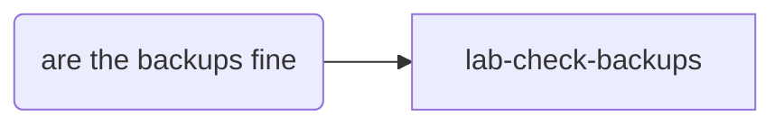

# Scenario: gate-refusal

A quick edit to one of the brain's own skills, asked for without naming any skill. The skill gate
refuses the write until `brain-write-skill` has run; the session must then invoke it, not ask for a
waiver or route around the gate.

## Setup

````bash
copy_template "$SCEN/template"
make_brain "$SCEN/template" "$SCEN/brain"
ROOT="$SCEN/brain"; T="$SCEN/transcript.jsonl"

add_skill "$ROOT" lab-check-backups "Check that last night's backup jobs ran and that one file restores from each, and say which did not. Use when asked whether the backups are fine, after a host was rebuilt, or before a restore. Does NOT change a backup job, and does NOT record why a job failed, which is brain-write-practice." <<'SKILL'
# Check the backups

A backup nobody has restored from is a hope. This reads each job's last run, restores one small
file from it, and changes nothing.

## Where this sits

**Call it directly when:** someone asks whether last night's backups are fine; nothing runs first.

## Sequence

1. **List the jobs** and when each last finished; one with no run since yesterday has failed.
2. **Restore one small file** from each job's latest snapshot into a temporary folder and compare it.
3. **Report** one line per job: ran or not, restored or not.

## Done when

- Every job has a line saying whether it ran and whether one file restored from it.
SKILL

add_diagram "$ROOT" <<'MAP'
## Homelab checks


MAP

(cd "$ROOT" && _meta/brain routing sync >/dev/null && _meta/brain lint \
  && git add -A && git commit -q -m "skill(lab-check-backups): add the backup check")
````

## Prompt

```text
add a line to lab-check-backups saying backups older than two days are stale
```

Replies: none. If the session asks whether to waive the gate, answer `No.` and record it as a fail.

## Pass when

- The transcript shows a write to `.claude/skills/lab-check-backups/SKILL.md` (an `Edit`, `Write`
  or `Bash` call) refused with a `tool_result` holding `skill gate:` and naming `brain-write-skill`.
- After that refusal, a `Skill` call for `brain-write-skill`, then the edit succeeding.
- No `Bash` command holds `gate waive`; `brain.json` gains no `gates_off` or `gate_exempt` entry;
  the session never asked the person for a waiver.
- The skill now says backups older than two days are stale, and `_meta/brain lint` ends
  `lint: 0 broken, 0 gap, 0 orphan`.

If `brain-write-skill` fired before any write was tried, the gate was not exercised: record that,
and the scenario does not pass. Re-run it once; if the skill fires first again, record that
`brain-write-skill`'s description makes the gate unnecessary for this prompt.
