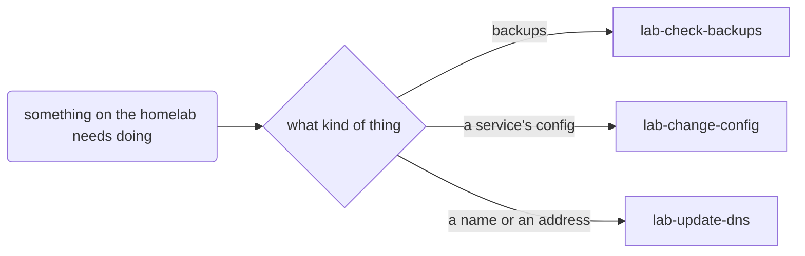

# Scenario: router-fan-out

Three work skills sit behind one entry point with only a decision node between them. Choosing by
reading drifts, so the person asks for routing that does not.

## Setup

````bash
copy_template "$SCEN/template"
make_brain "$SCEN/template" "$SCEN/brain"
ROOT="$SCEN/brain"; T="$SCEN/transcript.jsonl"

add_skill "$ROOT" lab-check-backups "Check that last night's backup jobs ran and that one file restores from each, and say which did not. Use when asked whether the backups are fine, after a host was rebuilt, or before a restore. Does NOT change a backup job, which is lab-change-config, and does NOT record why a job failed, which is brain-write-practice." <<'SKILL'
# Check the backups

A backup nobody has restored from is a hope. This reads each job's last run, restores one small
file from it, and changes nothing.

## Where this sits

**Call it directly when:** someone asks whether last night's backups are fine; nothing runs first.

## Sequence

1. **List the jobs** and when each last finished; one with no run since yesterday has failed.
2. **Restore one small file** from each job's latest snapshot into a temporary folder and compare it.
3. **Report** one line per job: ran or not, restored or not.

## Done when

- Every job has a line saying whether it ran and whether one file restored from it.
SKILL

add_skill "$ROOT" lab-change-config "Change a service's configuration on a homelab host: write the change, show the diff, and apply it only on the person's yes. Use when a setting, a port or a container version needs changing. Does NOT check backups, which is lab-check-backups, and does NOT change a name or an address, which is lab-update-dns." <<'SKILL'
# Change a service's config

A config change applied to a live host is hard to take back, so it is shown before it is applied.

## Where this sits

**Call it directly when:** a config change is already decided and only needs writing and applying.

## Sequence

1. **Write the change** next to the current config, never over it.
2. **Show the diff** and wait for the person's yes.
3. **Apply it** and check the service answers.

## Done when

- The person saw the diff and said yes, and the service answers after the change.
SKILL

add_skill "$ROOT" lab-update-dns "Add, change or remove a DNS name or a fixed address on the home network, in the one place they are kept. Use when a host needs a name, moves to a new address, or a name stopped resolving. Does NOT change a service's config, which is lab-change-config, and does NOT check backups, which is lab-check-backups." <<'SKILL'
# Update a name or an address

Names and fixed addresses live in one place; a second copy drifts.

## Where this sits

**Call it directly when:** a host needs a name or a new fixed address.

## Sequence

1. **Find the record** in the one place names are kept.
2. **Change it** and show the person the old and new lines.
3. **Check it resolves** from a second machine.

## Done when

- The name resolves to the new address from a second machine.
SKILL

add_diagram "$ROOT" <<'MAP'
## Homelab work


MAP

(cd "$ROOT" && _meta/brain routing sync >/dev/null && _meta/brain lint \
  && git add -A && git commit -q -m "skill(lab-check-backups): add three homelab work skills")
````

`lint` must print `lint: 0 broken, 0 gap, 0 orphan` before the run starts.

## Prompt

```text
everything I bring in should go to the right one of these
```

Replies, in order, each only when the turn ended on a question:

1. `The three homelab skills. Route on what kind of thing it is: backups, a service's config, or a
   name or address. Anything else should end up somewhere I can see it later.`
2. `Yes, go ahead.`

## Pass when

- The transcript has a `Skill` call for `brain-write-skill`, and none for a skill-writing lookalike.
- `.claude/skills/lab-router/SKILL.md` and `.claude/skills/lab-router/rules.json` exist.
- `rules.json` has a rule for each of the three skills and a `default`, and a case for each rule
  and one for the default; `_meta/brain route lab-router --check` prints `ok     lab-router: …`.
- The map routes through it: `_meta/brain routing show lab-router` shows it reached from the entry
  and handing to the three skills, and `routing show lab-check-backups` shows `lab-router` up.
- The router's description names all three skills it routes to, after "Does NOT".
- `_meta/brain lint` ends `lint: 0 broken, 0 gap, 0 orphan`; `_meta/brain routing sync --check`
  passes.
- The three work skills' own text (outside their generated blocks) is unchanged, unless a sibling
  name in a description had to change.
